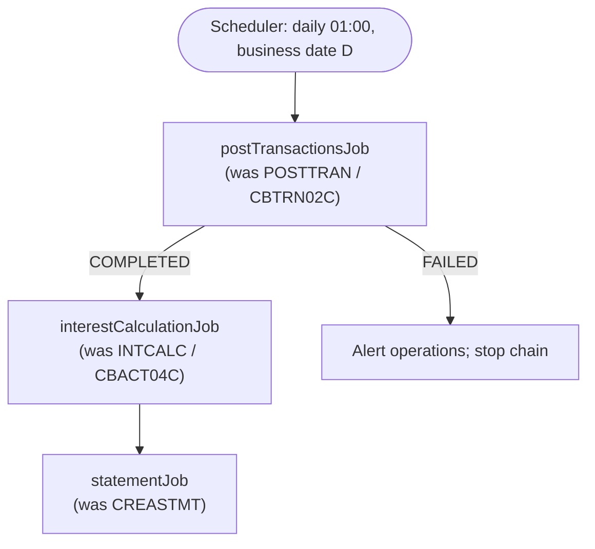

# Batch: JCL + COBOL batch → Spring Batch

## Mapping table (defaults; alternatives at the end)

| Legacy | Spring Batch default | Notes |
|---|---|---|
| JOB | `Job` (`@Bean Job intcalcJob`) | One job per JCL job unless steps are pure housekeeping |
| Scheduler (CA-7, Control-M, TWS) calendar, triggers, dependencies | Enterprise scheduler calling the job (Control-M agent, Kubernetes CronJob, Airflow) or Spring Batch + Quartz | Keep the scheduler definitions as the source of truth for timing (BRD §10 NFR, SRD §17) |
| STEP `EXEC PGM=<COBOL>` reading records, writing records | Chunk-oriented `Step`: `ItemReader` → `ItemProcessor` → `ItemWriter`, commit interval = legacy checkpoint frequency (or 500–1000) | Processor holds the business logic (rules RUL-nnn), unit-tested in isolation |
| STEP that runs a whole-table operation | `Tasklet` with one SQL statement | Often faster in DB2 than row-by-row |
| Sequential input DD | `FlatFileItemReader` (fixed-length `FixedLengthTokenizer` from the copybook) or a staging table | Byte layout from the data mapping draft |
| VSAM KSDS input | `JdbcCursorItemReader` / `JdbcPagingItemReader` on the migrated table, `ORDER BY` key | Paging reader for restartability |
| Output DD (new dataset) | `FlatFileItemWriter` or `JdbcBatchItemWriter` | |
| GDG `(+1)` | Timestamped file name / object-storage key, or a table partitioned by run date | Retention = GDG LIMIT (records-retention requirement) |
| `COND=` / `IF RC` | `JobExecutionDecider` / `.on("FAILED").to(...)` flows; map return codes to `ExitStatus` | Write the RC table in the FRD (BAT-nn) |
| `RETURN-CODE 4/8/12/16` | Custom `ExitStatus` ("COMPLETED_WITH_WARNINGS", "FAILED") | |
| Checkpoint/restart (`CHKP`, commit counts, restart parms) | `JobRepository` metadata; restart from the last committed chunk; idempotent writers | |
| `SORT` with `INCLUDE/OMIT/SUM` | `ORDER BY`/`WHERE`/`GROUP BY` in the reader query, or a sort step for files | Control cards hide business rules; extract them to RUL-nnn |
| `IDCAMS REPRO` | Data load (migration tooling) or `Tasklet` | DEFINE/DELETE: dropped |
| `IEBGENER`/copy | Dropped or a `Tasklet` | |
| `IKJEFT01` + `RUN PROGRAM(p) PLAN(x)` | The COBOL program `p` is the step; PLAN = DB2 package binding (none in Java) | |
| Report (`SYSOUT`, Easytrieve, print files with carriage control) | Report step producing PDF/CSV, or a reporting tool; or an online report | Confirm who still reads it (BRD §12) |
| Intra-job temp datasets `&&TEMP` | In-memory/stream between steps, or a staging table | |
| Restart parm cards / date cards (`DATEPARM`) | Job parameters (`run.date`) | Make the business date explicit, never `now()` |

## Design rules

- **Business date as a job parameter.** Legacy batch runs "for" a business date that often differs from the wall clock.
- **Idempotent and restartable.** Re-running a failed job must not double-post: use the processed-flag/key, an upsert, or
  a run-id column plus delete-before-rerun.
- **Same order, same results.** COBOL logic often depends on sort order and control breaks; reproduce `ORDER BY` exactly,
  including EBCDIC vs ASCII collation (digits sort after letters in EBCDIC) when keys mix letters and digits.
- **Control breaks** (totals per account/category) → processor with state keyed on the break field, or SQL `GROUP BY`
  when nothing else happens per record.
- **Error records** (reject files) → skip policy with a `SkipListener` writing to a reject table/file with reason codes;
  set skip limits from the business tolerance.
- **Throughput**: size the commit interval and use partitioning (by key range) when the batch window in the BRD requires it;
  state the window and volumes as NFRs.

## Batch flow diagram for the FRD/SRD

## Alternatives (ADR candidates)

- Keep batch on a rehosted COBOL runtime during the first waves (lower risk, slower modernization).
- Cloud-native orchestration (Step Functions, Airflow, Argo Workflows) around containerized steps.
- Stream processing (Kafka) when the business wants near-real-time instead of nightly posting: that is a business change and belongs in the BRD.
