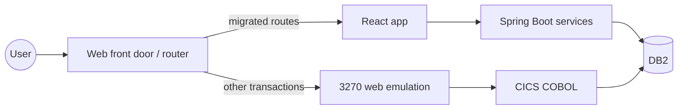

# Migration strategy and functional-equivalence testing

## Strategy options (pick per domain, record as ADRs)

| Strategy | What it means | When |
|---|---|---|
| Rewrite (re-architect) | Requirements recovered from code → new React/Spring Boot/DB2 implementation | Business wants change; code quality poor; long-term target. **This project's default.** |
| Refactor (automated conversion) | Tools convert COBOL to Java (for example AWS Transform / Blu Age, others), then refactor | Speed matters more than idiomatic code; large estates |
| Rehost / replatform | Run COBOL on a non-mainframe runtime | Interim step to exit hardware quickly |
| Retain / retire | Keep on the mainframe, or switch off | Low value or soon replaced; dead code found by the inventory |

## Wave planning

1. Use `docs/analysis/domains.md` (data-affinity clusters) to propose bounded contexts; confirm with the business.
2. Order waves by risk and dependency: reference data and read-only inquiry first, then maintenance screens, then
   core posting/batch, and shared data (system-of-record switch) last.
3. Per wave: scope (transactions, jobs, tables), coexistence mechanism, data sync, cutover, rollback.

## Coexistence (strangler)

- **Online:** a router (API gateway / web front door) sends migrated routes to React and leaves the rest on 3270
  (web emulation). Single sign-on across both. Menu links between old and new.
- **Data:** while both sides write, one system of record per entity; replicate (CDC) the other way. Avoid dual writes.
- **Batch:** migrated jobs read/write the same data as the remaining legacy jobs; schedule them in the same scheduler.

## Functional-equivalence testing

The question for every requirement drawn from code: does the new system produce the same result for the same input,
except for deliberate changes listed in the FRD?

| Technique | Use for |
|---|---|
| Golden-master batch comparison | Run legacy and new jobs on the same input files/DB snapshot and business date; compare outputs field by field (files, tables, reports) with a copybook-aware diff |
| Online record and replay | Capture 3270 sessions (inputs and screens) and replay them as API/UI tests against the new system |
| Rule-level unit tests | One test class per RUL-nnn with the legacy input/output pairs, especially calculations (to the cent, rounding) |
| Parallel run | Both systems process production-like volume for N cycles; reconcile totals daily before cutover |
| Data reconciliation | After each migration rehearsal: counts, control totals, sampled field comparison |
| Performance | Batch window and online p95 against BRD/SRD NFRs at production volumes |

Every test case links its requirement IDs (FR/SR/RUL) so the RTM can show verification status. Failed equivalence
is either a defect or a newly found rule: when it's a rule, add the RUL, bump the BRD, and trace it through.

## Cutover checklist (SRD §18.2)

Freeze window, final delta migration, reconciliation sign-off, routing switch, smoke tests, hypercare, rollback trigger
and steps (with the data written after cutover), legacy decommission date, archive of legacy data for retention.
