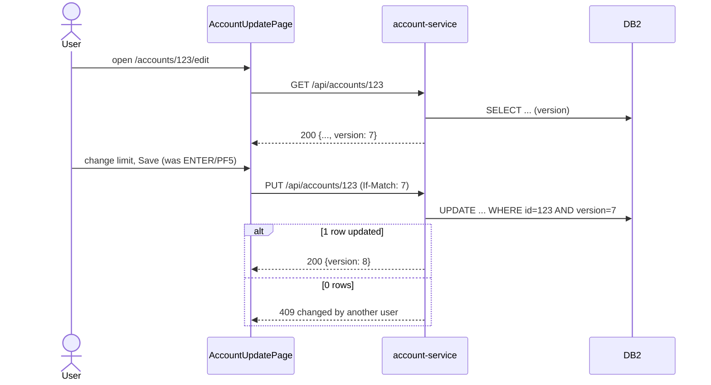

# Online: CICS/BMS → React + Spring Boot REST

## Contents
1. Mapping table
2. Pseudo-conversation → stateless REST
3. Screen → React page
4. Program logic → service layer
5. Errors and messages
6. Security
7. Alternatives to record as ADRs

## 1. Mapping table (recommended defaults; override per program with an ADR)

| Legacy | Target default | Notes |
|---|---|---|
| Transaction ID (CSD `DEFINE TRANSACTION`) | React route (`/accounts/:id`) + menu entry | Keep the TRANSID in route metadata for traceability and for coexistence routing |
| BMS mapset/map | React page component + form schema (zod/yup) | One page per map; shared header/footer becomes layout |
| Map field `UNPROT` (+`NUM`, `LENGTH`) | Controlled input with `maxLength`, numeric/pattern validation | Validate client-side for UX **and** server-side (Bean Validation) for integrity |
| Map field `PROT`/`ASKIP` named | Read-only display bound to DTO | |
| `DRK` field | `type="password"` | |
| `IC` attribute | `autoFocus` | |
| ERRMSG field | Inline field errors + page alert region (`role="alert"`) | |
| PF keys (`EIBAID`) | Buttons + keyboard shortcuts: ENTER=submit, PF3=back, PF7/PF8=prev/next page, PF12=cancel, PF5=refresh/save | Keep shortcuts for power users during transition; document in FRD §7 |
| `RECEIVE MAP` → edit paragraphs | `POST/PUT` handler → `@Valid` DTO → service validation | Field edits → DTO constraints; cross-field/business edits → service (rules from RUL-nnn) |
| `SEND MAP` | JSON response rendered by the page | |
| COMMAREA (state across interactions) | Client state (React Query cache / form state) + IDs in the URL; server stays stateless | If state is sensitive or large, server-side session/token store (ADR) |
| `RETURN TRANSID` | End of request (HTTP response) | |
| `XCTL` | Client navigation (`navigate('/route')`) | |
| `LINK` to a business program | Spring `@Service` method (in-process) or internal REST call if a separate service | Shared routines (date, validation) → library module |
| `READ FILE` / `READ … UPDATE` + `REWRITE` | `GET` → JPA/JDBC read; `PUT` with optimistic version (`@Version` column or ETag/If-Match) | Replaces the record lock held across a user think-time, which never exists in stateless REST |
| `STARTBR/READNEXT/READPREV` | Keyset pagination `GET /items?after={key}&size=n` (and `before=` for PF7) | Not OFFSET: keyset matches VSAM browse semantics and performs on DB2 |
| `WRITEQ TS` paging state | Cursor/key in client state | |
| `SYNCPOINT` / implicit task-end commit | `@Transactional` on the service method | One HTTP request = one unit of work by default |
| `SYNCPOINT ROLLBACK` / ABEND | Exception → rollback → error response | |
| `ASSIGN USERID` | `SecurityContextHolder` principal | |
| `START TRANSID` (async) | `@Async`, message queue, or scheduled job | |
| `WRITEQ TD` (logging/trigger) | Structured log / event / message | |
| `HANDLE ABEND` | `@ControllerAdvice` | |

## 2. Pseudo-conversation → stateless REST

A CICS pseudo-conversational program is a state machine re-entered on every key press: `EIBCALEN = 0` means first
time (send empty map), otherwise it receives the map and branches on `EIBAID` and a state flag in the COMMAREA. Map it as:

1. Draw the state machine first (Mermaid `stateDiagram-v2`) from the program's `EVALUATE EIBAID`/state flags.
   This goes in the FRD (screen behaviour) and anchors the React page states.
2. Each transition that reads or changes data → one REST operation. Transitions that only change what is shown → client-only.
3. Data that the program kept in COMMAREA between screens becomes URL parameters (IDs), client state
   (unsaved edits, list position) or, rarely, server state.
4. "Read for update, show to user, rewrite on confirm" becomes `GET` (returns `version`) → user edits → `PUT` with
   `If-Match`/`version` → `409 Conflict` if someone else changed it. CardDemo-style programs often compare old/new
   values before rewrite; that check maps exactly to optimistic concurrency.

## 3. Screen → React page

- Generate the form from the screens report (`docs/analysis/screens.md`): field order by `POS`, labels from INITIAL
  literals, `maxLength` from LENGTH, numeric from NUM. Don't copy the 24×80 layout: group fields semantically
  and keep the label wording the users know (unless the BRD changes it).
- Composite fields (date as YYYY/MM/DD in three inputs, phone as three parts) → one typed input with validation.
- List screens (selection column with `S`/`U`/`D` codes) → table with row actions and keyset pagination.
- Menus driven by option tables (`COMEN02Y`-style copybooks) → route config + role-based visibility.
- Accessibility: labels bound to inputs, keyboard operation, focus management after submit/errors, WCAG 2.2 AA.
- Suggested stack (pin versions in SRD §4): React + TypeScript, React Router, TanStack Query, React Hook Form + zod,
  a component library, Vitest + Testing Library, Playwright for E2E.

## 4. Program logic → service layer

| COBOL structure | Spring Boot |
|---|---|
| Edit paragraphs (`1200-EDIT-*`) | Bean Validation on DTOs + a `Validator`/domain method per business rule (named after RUL-nnn) |
| Process/update paragraphs | `@Service` methods, `@Transactional` |
| File/table access paragraphs | Spring Data JPA repositories or JdbcTemplate/jOOQ for SQL-heavy code |
| Copybook record | JPA `@Entity` (persistent) and/or DTO `record` (API); never expose entities directly |
| 88-level code domains | Java `enum` with the legacy code as a field + JPA `AttributeConverter` |
| `COMPUTE … ROUNDED` | `BigDecimal` with explicit scale and `RoundingMode.HALF_UP` |
| Shared CALLed utilities | Library module with unit tests built from legacy input/output pairs |

Package by feature (`account`, `card`, `transaction`), not by layer. Each FR maps to a controller endpoint and a service method:
record that mapping in SRD §5/§18.

## 5. Errors and messages

Map `RESP` conditions and SQLCODEs to HTTP codes in one place: NOTFND/+100 → 404, DUPREC/−803 → 409, validation → 400
(Problem Details `application/problem+json` with field errors), INVREQ/unexpected → 500 with a correlation ID.
Keep the legacy message texts as the default English messages (FRD §12), in a message bundle keyed by MSG-nnn.

## 6. Security

RACF/ACF2/Top Secret profiles and transaction security → roles; user-type fields in the user file (for example admin vs
regular) → role claims. Prefer the enterprise IdP (OIDC) with Spring Security resource server; sign-on screens that checked a
password file are replaced, not ported. Plaintext legacy passwords must never be migrated (SRD §8, §9).

## 7. Alternatives to record as ADRs

- Server-rendered UI or keeping 3270 emulation for a transition period.
- One service vs. several (start with a modular monolith per bounded context; split when there is a reason).
- Rehosting COBOL (Micro Focus / Rocket / Heirloom / AWS Blu Age runtime) for some programs instead of rewriting.
- GraphQL or BFF instead of plain REST for screen-shaped APIs.
