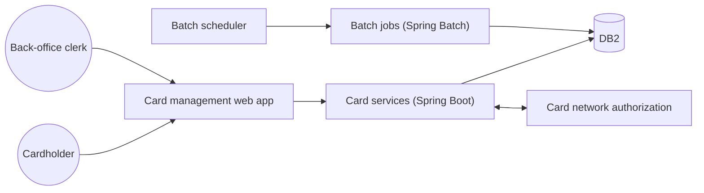
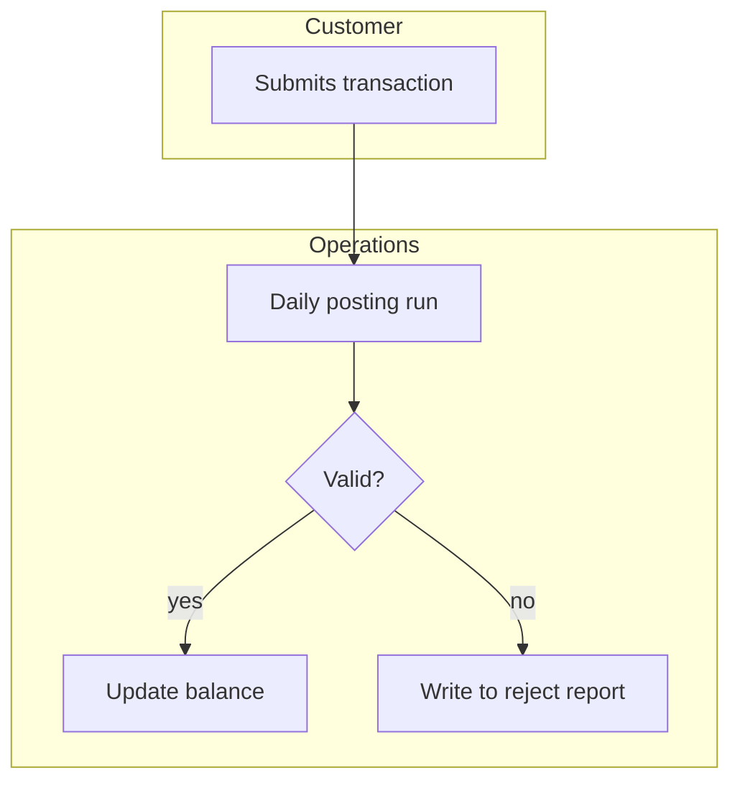
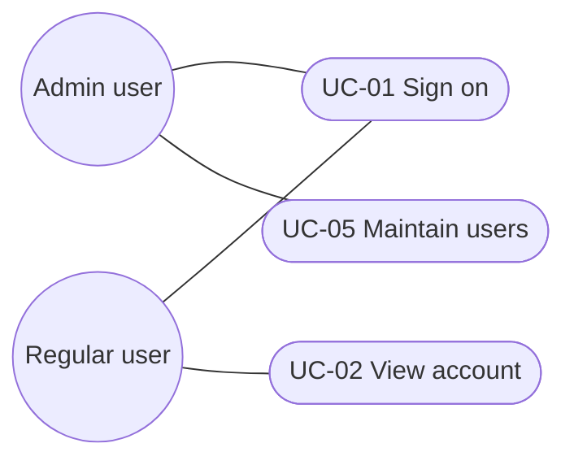
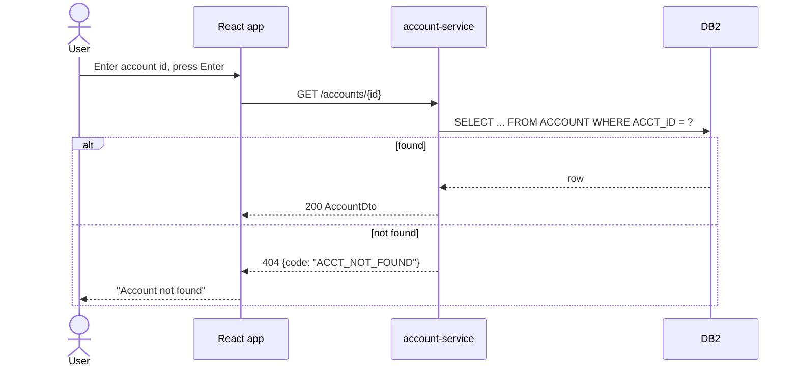
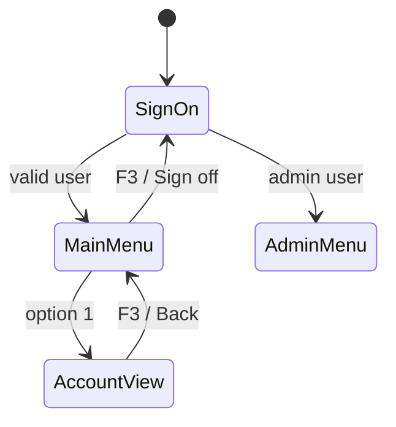
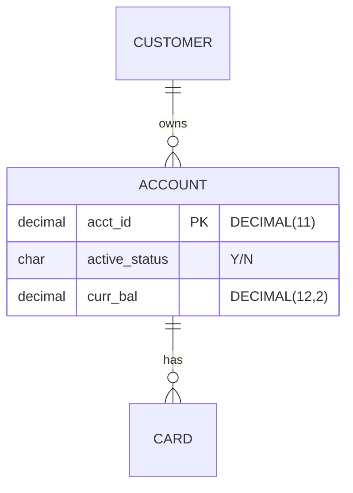
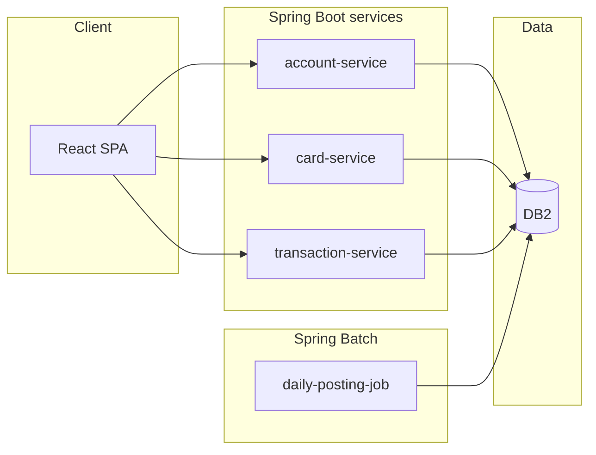

# Diagrams (Mermaid)

Use Mermaid in fenced ```` ```mermaid ```` blocks. It renders in GitHub, GitLab, VS Code, Confluence
(with a macro) and most Markdown viewers, needs no installed tool, and diffs as text between versions.
Every diagram gets a one-line caption above it saying what it shows, and the prose still has to stand on
its own without the diagram.

## Which diagram where

| Need | Mermaid type | Typical section |
|---|---|---|
| System context (actors, system, external systems, stores) | `flowchart LR` | BRD §7, FRD §2, SRD §2 |
| Business process with responsibilities | `flowchart TD` with one `subgraph` per actor (swimlanes) | BRD §7, §8 |
| Use-case overview (UML use case) | `flowchart LR` with actor nodes `(("Actor"))` and use cases `(["Use case"])` | FRD §4 |
| Interaction over time (UML sequence) | `sequenceDiagram` | FRD §4 per UC, SRD §3 |
| Screen navigation / lifecycle (UML state machine) | `stateDiagram-v2` | FRD §7 (navigation), FRD §6.3 (entity states), BRD §11 state rules |
| Domain/class model (UML class) | `classDiagram` | FRD §6.1 (alternative to ER), SRD §3 |
| Data model | `erDiagram` | BRD §12.2 (conceptual), FRD §6.1 (logical), SRD §7.1 (physical) |
| Components (UML component / C4 container) | `flowchart LR` with `subgraph` per tier | SRD §3 |
| Deployment (UML deployment) | `flowchart TB` with `subgraph` per node/environment | SRD §4 |
| Batch job chain | `flowchart TD` | FRD §9, SRD §17 |
| Migration plan | `gantt` | SRD §18.2 |

Required minimums (checked by `docver.py validate`): BRD §7, §8, §12; FRD §2, §4, §6, §7; SRD §2, §3 (two), §4, §7, §17.

Mermaid has no native UML use-case or component diagram. The flowchart patterns below are the conventional stand-ins.

## Patterns

Context:


Swimlane process:


Use-case overview:


Sequence (pseudo-conversational CICS replaced by REST):


Screen navigation:


ER (attribute types are single words; put lengths in the comment):


Components:


## Syntax traps (docver.py validate catches the first three)

- Quote labels containing `(`, `)`, `:`, `/`, `#` or punctuation: `A["Read file (VSAM)"]`.
- `end` is reserved in flowcharts; use `End1` or `done` as the node id.
- `erDiagram` attribute types can't contain `(n)`: write `decimal amount "DECIMAL(12,2)"`.
- Node ids are letters/digits/underscore only; put the readable name in the label.
- Keep diagrams under ~25 nodes; split by capability rather than drawing the whole estate.
- `classDiagram` generics use `~`: `List~Card~`.

## Optional rendering check

When Node is available, `npx -y @mermaid-js/mermaid-cli -i doc.md -o out.md` renders every block and fails
on syntax errors (it downloads a headless browser the first time). Run it before a baseline (major) version.
