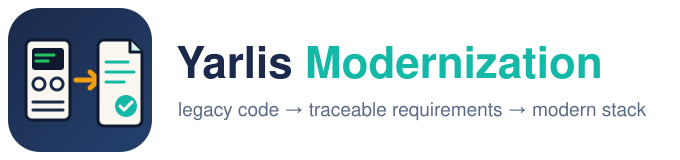
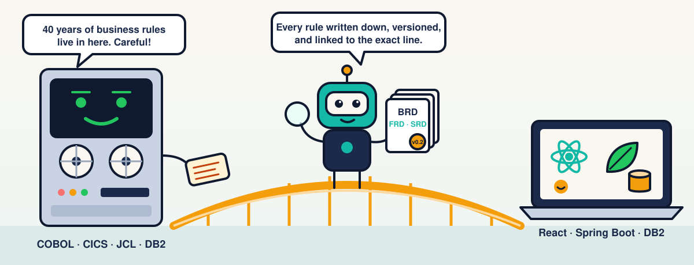
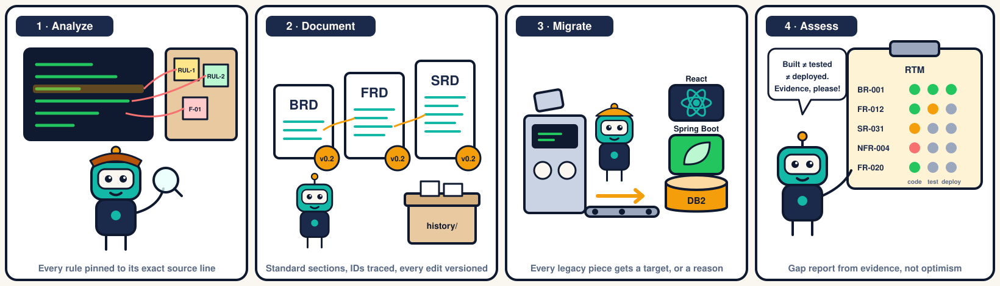
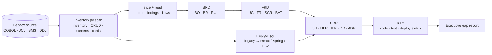

<p align="center">
  
</p>

<p align="center">
  <b>Claude Code skills that turn legacy code into versioned, traceable requirements (BRD → FRD → SRD → RTM) and a React + Spring Boot + DB2 migration design.</b>
</p>

<p align="center">
  <a href="LICENSE"></a>
  
  
</p>

<p align="center"></p>

Mainframe applications hold decades of business rules that nobody has written down. Rewriting them without
first recovering those rules is the main way migrations fail. This repository packages that recovery as three
[Claude Code skills](https://docs.claude.com/en/docs/claude-code/skills). Each comes with deterministic scripts
(Python standard library only), standard templates and reference guides:

| Skill | What it does |
|---|---|
| [`legacy-code-analysis`](.claude/skills/legacy-code-analysis/SKILL.md) | Scans any source tree (deep support for COBOL, CICS, BMS, JCL, DB2, VSAM, IMS, MQ; generic support for Java, .NET, Python, JS and others). It builds an inventory, call/transfer graph, CRUD matrix, data dictionary, screens, batch flows and candidate domains, plus one card per program with every reference linked to its source line. |
| [`requirements-docs`](.claude/skills/requirements-docs/SKILL.md) | Writes BRD, FRD and SRD from fixed templates, plus a project context, a Requirements Traceability Matrix with separate code / test / deployment status, and an Executive Gap Report. Every change bumps the semantic version, adds a revision row and snapshots the previous version. `docver.py` validates structure, ID traces, diagrams, evidence links and staleness. |
| [`mainframe-modernization`](.claude/skills/mainframe-modernization/SKILL.md) | Maps legacy artifacts to the target stack: transaction → route, BMS map → React form, CICS program → REST + Spring service, JCL → Spring Batch, copybook/VSAM → DB2 + JPA. Its guides cover pseudo-conversational state, COMMAREA, SYNCPOINT, COMP-3, EBCDIC ordering, GDGs, restart, coexistence waves and functional-equivalence testing. |

## How it works

<p align="center"></p>



1. **Analyze**: `inventory.py scan` reads the whole tree in seconds. It handles fixed-format COBOL columns, resolves dynamic
   `XCTL/LINK/CALL` targets (including table-driven menus) and DB2 batch programs behind `IKJEFT01 RUN PROGRAM`, then
   `slice` lists exactly what to read for one capability. Claude reads it and extracts business rules as **candidates**
   with a confidence level, plus a register of legacy defects.
2. **Document**: `docver.py init` creates each document from its template. The structure is fixed (BRD 21 sections, FRD 17,
   SRD 23), sections that don't apply say `N/A: reason`, and unknowns stay **Unknown** as open questions with an owner.
3. **Iterate**: every change follows the same protocol. Bump first (the old version is saved in `history/`), edit, then run
   `linkify`, `trace --inject` and `validate`. Downstream documents are flagged **STALE** when their upstream moves.
4. **Assess**: `rtm sync` builds one row per requirement, and the assessment fills in code, verification and deployment status
   from linked evidence. `rtm summary` feeds the gap report. It shows counts, not percentages, unless priorities are agreed.

**Evidence is a link, never a copy.** `path:line` references become permalinks pinned to the analyzed commit
(GitHub / GitLab / Bitbucket / Azure DevOps), or relative links when there's no git remote. `validate` warns on
pasted legacy code and unlinked references.

## Quick start

```bash
# 1. Get the skills: clone, then use this folder as your project or copy the skills to your user skills
git clone https://github.com/YarlisAISolutions/yarlis-modernization.git
cp -r yarlis-modernization/.claude/skills/{legacy-code-analysis,requirements-docs,mainframe-modernization} ~/.claude/skills/

# 2. In your migration project, ask Claude Code, for example:
#    "Analyze the code in ./legacy for sign-on and user admin (CC00, CU00-CU03) and write the BRD."
#    Or paste a template from prompts/ and fill in the brackets.
```

The scripts also run on their own:

```bash
S=~/.claude/skills
python3 $S/legacy-code-analysis/scripts/inventory.py scan   --src ./legacy --out docs/analysis
python3 $S/legacy-code-analysis/scripts/inventory.py slice  --inventory docs/analysis/inventory.json --root CC00 CU00 --depth 2
python3 $S/legacy-code-analysis/scripts/inventory.py domains --inventory docs/analysis/inventory.json
python3 $S/mainframe-modernization/scripts/mapgen.py --inventory docs/analysis/inventory.json --programs COSGN00C
D=$S/requirements-docs/scripts/docver.py
python3 $D init --type context --dir docs/requirements --project "Card Demo" --src ./legacy
python3 $D new-feature --module user-admin --feature sign-on          # BRD + FRD + SRD in docs/requirements/user-admin/sign-on/
F=docs/requirements/user-admin/sign-on
python3 $D bump $F/BRD.md --level minor --summary "CR-001: audit trail" --sections "10, 11"
python3 $D linkify $F && python3 $D trace $F --inject && python3 $D validate $F
python3 $D rtm sync $F && python3 $D rtm summary $F
python3 $D index docs/requirements && python3 $D check docs/requirements      # catalogue + CI gate
```

## Use with GitHub Copilot (and any team)

The skills follow the open [Agent Skills](https://code.visualstudio.com/docs/agent-customization/agent-skills) format.
GitHub Copilot in VS Code, Copilot CLI and the Copilot cloud agent load them straight from `.claude/skills/`, the same folder
Claude Code uses, so there's one copy for both. One command installs the full team kit into your repository:

```bash
yarlis-modernization/scripts/install.sh /path/to/your-repo     # --dry-run first if you like
```

- **Copilot files:** repo-wide `copilot-instructions.md` and `AGENTS.md`, path-scoped `.instructions.md` files for
  `docs/requirements/**`, the slash commands `/new-feature-requirements`, `/analyze-legacy`, `/change-request` and
  `/assess-implementation`, a `requirements-analyst` custom agent with BRD → FRD → SRD handoffs, and `copilot-setup-steps.yml` for the cloud agent.
- **Per-feature layout:** `docs/requirements/<module>/<feature>/{BRD,FRD,SRD}.md`, scaffolded with `docver.py new-feature`, plus a
  generated `INDEX.md` catalogue showing versions and STALE flags.
- **Guardrails:** a CI workflow (`docver.py check` for structure, traces, layout, unique IDs and index; `bumpcheck` so no edit merges
  without a version bump), a PR checklist, and an issue form you can assign to Copilot.

Team conventions, ownership, the review flow and the commonly missed items are in [docs/ADOPTION.md](docs/ADOPTION.md).

## Prompt templates

[`prompts/`](prompts/README.md) has a **standard prompt structure** (role, context, task, scope, inputs, deliverables,
rules, verification) and ready-to-fill prompts for each step: analyze, BRD, FRD, SRD, change request, implementation
assessment, plus a master prompt for the whole package.

## Document standards

| Document | Sections | IDs it defines | Must trace to |
|---|---|---|---|
| BRD: Business Requirements | 21: control, summary, context, vision, objectives, stakeholders, as-is, to-be, scope, requirements, rules, data, benefits, ADC, risks, compliance, transition, acceptance, questions, glossary, appendices | BO, BR, RUL, ASM/CON/DEP, RSK | BR → BO |
| FRD: Functional Requirements | 17: overview, roles, use cases, FRs (actor, flows, rules, Given/When/Then), data and states, UI and accessibility, reporting, batch, integrations, auth and audit, errors, verification … | UC, FR, SCR, BAT, RPT, INT, MSG | FR → BR |
| SRD: System Requirements (ISO/IEC/IEEE 29148-aligned) | 23: context, architecture, runtime and deployment, SRs, interfaces, data, security, privacy, performance, availability, observability, compatibility, operations, CI/CD, compliance, batch and transactions, legacy mapping and migration, verification, ADRs … | SR, NFR, IFR, DR, ADR | SR → FR |
| RTM | matrix + status definitions + conflicts | rows for BR, RUL, FR, SR, NFR, IFR, DR | |
| Gap report | scope, counts, implemented-not-verified, gaps, blockers, next milestone, limitations | | RTM IDs |

Required Mermaid/UML diagrams per document (context, swimlane process, use case, sequence, state, ER, component, deployment,
batch flow) are checked by `validate`. See [`diagrams.md`](.claude/skills/requirements-docs/references/diagrams.md).

## Results

Tested on the open-source [AWS CardDemo](https://github.com/aws-samples/aws-mainframe-modernization-carddemo) mainframe
application (COBOL, CICS, BMS, JCL, VSAM, DB2, IMS, MQ; not included here). The scanner found 46 programs, 25 transactions,
46 jobs and 21 screens, with no unresolved references. Two tasks were run, each with and without the skills:

| | With skills | Without |
|---|---|---|
| Assertions passed (sign-on BRD; full BRD→FRD→SRD + audit change request) | **100%** | 56% |
| Assertions passed (RTM + gap report: "how much of this BRD is built?") | **100%** | 85% |
| Mermaid diagrams | 5 / 20 | 0 / 0 |
| Evidence hyperlinked to source lines | 114 / 201 | 0 / 0 |
| Version bump + revision rows + snapshots on change | yes | partial |
| Time / tokens | ~1.8× / ~1.7× | 1× |

Both configurations found the same important legacy defects. The skills add the standard structure, versioned history,
traceability, diagrams and clickable evidence. Expect more time and tokens per run in exchange.

## Principles

- **Never invent.** Unknown facts stay Unknown, become open questions with owners, and every requirement states its basis.
- **Candidates until confirmed.** Rules recovered from code describe what the system does, not what the business wants.
- **Don't shrink scope to fit the code.** A requirement the code doesn't meet is a gap, not an edit.
- **Stable IDs, permanent history.** IDs are never renumbered, and every version is snapshotted.

## Repository layout

```
.claude/skills/
  legacy-code-analysis/     SKILL.md · scripts/inventory.py · references/
  requirements-docs/        SKILL.md · scripts/docver.py · assets/templates/ · references/
  mainframe-modernization/  SKILL.md · scripts/mapgen.py · references/
.github/                    Copilot instructions, prompt files, custom agent, CI workflows, PR template, issue form
AGENTS.md                   cross-agent instructions
prompts/                    standard prompt structure + per-step templates + master prompt
scripts/install.sh          installs the kit into another repository
tests/                      synthetic mainframe fixture + selftest.sh (run in CI)
docs/ADOPTION.md            team conventions and workflow
docs/images/                logo and cartoons (SVG)
```

## Contributing

Issues and pull requests are welcome. Conventional Commits, one feature branch per change. Run the scripts against a
sample codebase (CardDemo works well) before opening a PR, and keep the scripts dependency-free.

## License

[Apache-2.0](LICENSE) © Yarlis AI Solutions
