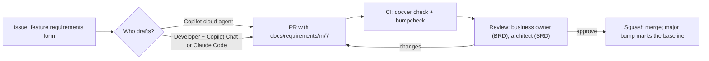

# Team adoption guide

How a team gets every developer, whether they use GitHub Copilot, Claude Code or neither, to produce the same per-feature
BRD/FRD/SRD documents and keep them honest.

## 1. Install once per repository

```bash
git clone https://github.com/YarlisAISolutions/yarlis-modernization.git
yarlis-modernization/scripts/install.sh /path/to/your-repo        # --dry-run to preview, --force to update
cd /path/to/your-repo
python3 .claude/skills/requirements-docs/scripts/docver.py init --type context --dir docs/requirements --project "<Name>" --src <legacy-source>
```

What lands in your repo, and who uses it:

| Path | Used by | Purpose |
|---|---|---|
| `.claude/skills/*` | Copilot (VS Code, CLI, cloud agent), Claude Code | The three Agent Skills: instructions, templates, scripts |
| `.github/copilot-instructions.md`, `AGENTS.md` | Copilot, Codex, Cursor, other agents | Repo-wide rules: layout, honesty, evidence links, versioning |
| `.github/instructions/*.instructions.md` | Copilot | Rules applied automatically when editing `docs/requirements/**` or `docs/analysis/**` |
| `.github/prompts/*.prompt.md` | Copilot Chat | Slash commands: `/new-feature-requirements`, `/analyze-legacy`, `/change-request`, `/assess-implementation` |
| `.github/agents/requirements-analyst.agent.md` | Copilot | A custom agent with handoffs BRD → FRD → SRD → assessment |
| `.github/workflows/requirements-check.yml` | CI | `docver.py check` + `bumpcheck` on every PR touching requirements |
| `.github/workflows/copilot-setup-steps.yml` | Copilot cloud agent | Python and full git history, so the scripts and permalinks work |
| `.github/ISSUE_TEMPLATE/feature-requirements.yml` | Everyone | Request a feature's documents; assign the issue to Copilot |
| `.github/pull_request_template.md` | Reviewers | Requirements checklist |
| `prompts/` | People | Human-readable prompt templates in the standard structure |

## 2. Conventions everyone follows

- **Folders:** `docs/requirements/<module>/<feature>/`, both kebab-case. A module is a business area (accounts, cards,
  user-admin). A feature is one capability a user would name (account-update, card-activation). The component (account-service,
  web-app) goes in front matter (`--component`), not the path, because features often span components.
- **One set per feature:** BRD, FRD and SRD always together in the feature folder; RTM and gap report when assessed.
- **IDs** are local to the feature folder. Cross-feature references use `module/feature#ID`.
- **Versions:** 0.x while drafting, 1.0.0 when approved (`bump --level major --status Approved`), minor for each later change.
  Never edit content without a bump; CI rejects it.
- **Index:** `docs/requirements/INDEX.md` is regenerated by `docver.py index` and committed with every change. CI fails if it's stale.
- **Evidence:** links to source lines, never pasted code. **Unknowns:** Unknown / TBD (decision needed, owner), never guesses.

## 3. Workflow



1. Open a **Feature requirements** issue, or run `/new-feature-requirements module=… feature=… scope=…` in Copilot Chat or Claude Code.
2. The agent scaffolds with `docver.py new-feature`, fills the BRD, then the FRD, then the SRD, and validates.
3. Open a PR on a `docs/<module>-<feature>` branch. CI checks it, and code owners review.
4. Later changes use `/change-request`: bump first, carry the change downstream, and the PR shows the revision rows.
5. When code is being built, run `/assess-implementation` to get the RTM and gap report for the feature.

## 4. Ownership and review

Add CODEOWNERS entries so the right people review each module's requirements:

```
docs/requirements/accounts/     @your-org/accounts-business-owners @your-org/architects
docs/requirements/user-admin/   @your-org/security-owners @your-org/architects
docs/requirements/PROJECT-CONTEXT.md  @your-org/product-leads
```

Turn on branch protection for the default branch, with the `requirements-check` job required.

## 5. Things teams usually forget

- **Glossary drift:** keep shared terms in the BRD glossary of the owning module and link to it from other features.
- **Stale downstream documents:** `INDEX.md` shows **STALE**. Treat a stale FRD/SRD as a blocker for implementation work on that feature.
- **SME confirmation:** schedule rule reviews. Rules stay Candidate until an SME confirms them, and approval (1.0.0) warns on remaining candidates.
- **Permalinks:** set `repo_ref` in `PROJECT-CONTEXT.md` to the analyzed commit, and refresh it (plus re-run linkify) when you re-baseline.
- **Secrets and data:** never paste production data or credentials into documents. Use links and describe the data instead.
- **Retire, don't delete:** a dropped requirement keeps its ID with `Status: Retired`, so tests and RTM rows still resolve.
