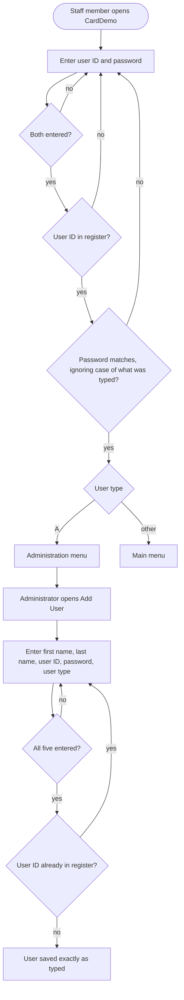
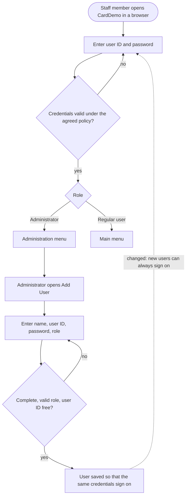
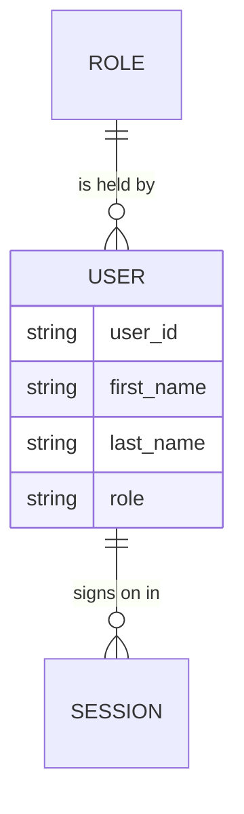

# CardDemo: Sign-on and Add User: Business Requirements Document (BRD)

<!-- Structure basis: IIBA BABOK v3 business-requirement concepts plus the common BRD section set.
Section numbers and titles are fixed; docver.py validates them in order. Write "N/A: <reason>" in a section
that does not apply instead of deleting it. Label unknown information "Unknown" (or TBD + the decision needed)
and add it to section 19. Never invent decisions, numbers or approvals.
IDs: BO-nn objective, BR-nnn business requirement, RUL-nnn business rule, ASM/CON/DEP-nn, RSK-nn.
IDs are permanent: never renumber; retire with "Status: Retired". -->

## 1. Document Control

### 1.1 Document Information

| Field | Value |
|---|---|
| Purpose | Defines the business need, outcomes and requirements for signing on to CardDemo and for adding a user |
| Owner | Demo owner |
| Version / date | see front matter and 1.2 |
| Approval status | Draft |
| Project context | PROJECT-CONTEXT.md |

### 1.2 Revision History

<!-- Maintained by docver.py bump. One row per version; newest last. -->

| Version | Date | Author | Change summary | Sections changed |
|---|---|---|---|---|
| 0.1.0 | 2026-11-05 | Claude (draft) | Initial draft | All |

### 1.3 Approvals

| Role | Name | Decision | Date |
|---|---|---|---|
| Business Sponsor | Unknown | Pending | |
| Product Owner | Unknown | Pending | |
| Business SME | Unknown | Pending | |

### 1.4 Source Baseline

- Source: AWS CardDemo at commit `59cc6c2fd7ebd7ef7925cad552a01a4b8b6e4d5e` (see PROJECT-CONTEXT.md), folder `app/`.
- Analysis: `l2m analyze scan` of the whole application (46 programs, 25 transactions, 0 unresolved references), then
  `l2m analyze slice --root CC00 CU01`: programs COSGN00C and COUSR01C, the user security file and two screens.
- Stakeholder input: none. Every requirement below is derived from code and is a candidate until a business SME confirms it.

## 2. Executive Summary

CardDemo is a credit card back-office application. Every staff member enters it through one sign-on screen, which checks a
user ID and password against the user register and sends administrators and regular users to different menus.
Administrators add new staff users on an Add User screen. The modernization replaces both screens with a web
application while keeping the same people, the same user register and the same two roles. The legacy behaviour has
defects that the business must decide on before the new system copies them: passwords are stored as entered but checked
in upper case, so a user added with a lower-case password can never sign on; the user type accepts any character; and
any sign-on attempt can be repeated without limit. This document states what the business needs from sign-on and user
creation, the rules recovered from the code (all candidates), and the questions an SME must answer. Success means every
current user signs on to the new system with the same role on day one, and no user is created who cannot sign on.

## 3. Business Context and Problem or Opportunity

### 3.1 Current Situation

Staff reach every CardDemo function through the sign-on screen ([`cbl/COSGN00C.cbl:73-102`](https://github.com/aws-samples/aws-mainframe-modernization-carddemo/blob/59cc6c2fd7ebd7ef7925cad552a01a4b8b6e4d5e/app/cbl/COSGN00C.cbl#L73-L102)). A user is identified by
an 8-character user ID and checked against an 8-character password held in the user register
([`cpy/CSUSR01Y.cpy:17-23`](https://github.com/aws-samples/aws-mainframe-modernization-carddemo/blob/59cc6c2fd7ebd7ef7925cad552a01a4b8b6e4d5e/app/cpy/CSUSR01Y.cpy#L17-L23)). Administrators create users one at a time on the Add User screen
([`cbl/COUSR01C.cbl:115-160`](https://github.com/aws-samples/aws-mainframe-modernization-carddemo/blob/59cc6c2fd7ebd7ef7925cad552a01a4b8b6e4d5e/app/cbl/COUSR01C.cbl#L115-L160)). The register is first loaded by a batch job with ten seed users
([`jcl/DUSRSECJ.jcl:35-44`](https://github.com/aws-samples/aws-mainframe-modernization-carddemo/blob/59cc6c2fd7ebd7ef7925cad552a01a4b8b6e4d5e/app/jcl/DUSRSECJ.jcl#L35-L44)).

### 3.2 Business Drivers

- Unknown: no stakeholder has stated why CardDemo is being modernized. The project context lists the target stack only.
- Assumed driver (to confirm, see Q-01): moving terminal screens to a browser so staff need no 3270 emulator.

### 3.3 Problem or Opportunity Statement

Sign-on is the entry to every function, so it must work for every current user from the first day of the new system.
The legacy rules for passwords and user types are inconsistent between the two programs, which today produces users who
cannot sign on and roles the system does not recognise. The modernization is the moment to decide which of these
behaviours the business keeps.

## 4. Product Vision and Desired Business Outcomes

Staff sign on to CardDemo in a browser with their existing user ID, land on the menu for their role, and administrators
add colleagues who can sign on straight away. Nobody needs a new account, and no account is created that cannot be used.

## 5. Objectives and Success Metrics

<!-- SMART objectives with KPI, baseline and target. Unknown baseline/target: "TBD (decision: ..., owner: ...)". -->

| ID | Objective | KPI | Baseline | Target | Owner |
|---|---|---|---|---|---|
| BO-01 | Every existing user can sign on to the new system with the same role | Share of register users who sign on successfully at cutover | Unknown | TBD (decision needed: acceptance threshold, owner: Business Sponsor) | Business Sponsor |
| BO-02 | Every user an administrator adds can sign on | Users added in the period who cannot sign on | Unknown (defect RSK-01 makes it non-zero today) | 0 | Product Owner |
| BO-03 | Only known users reach CardDemo functions | Sign-ons granted to an unknown user ID or a wrong password | Unknown | 0 | Security Officer (Unknown) |

## 6. Stakeholders, User Groups and Decision Owners

### 6.1 Stakeholder Register

| Stakeholder / Role | Interest | Influence | Responsibility (RACI) | Decision owner for |
|---|---|---|---|---|
| Business Sponsor (Unknown) | Modernization outcome | High | A | Scope, cutover acceptance |
| Product Owner (Unknown) | Requirements and priorities | High | R | BR priorities, deliberate changes |
| Security Officer (Unknown) | Credential and access policy | High | C | Password and lockout policy (Q-02, Q-03) |
| Administrators | Create users | Medium | I | None |
| Regular users | Sign on to do their work | Low | I | None |

### 6.2 User Groups and Personas

Two user types exist in the code, recorded on each user and used to choose the menu after sign-on
([`cpy/COCOM01Y.cpy:26-28`](https://github.com/aws-samples/aws-mainframe-modernization-carddemo/blob/59cc6c2fd7ebd7ef7925cad552a01a4b8b6e4d5e/app/cpy/COCOM01Y.cpy#L26-L28), [`cbl/COSGN00C.cbl:230-240`](https://github.com/aws-samples/aws-mainframe-modernization-carddemo/blob/59cc6c2fd7ebd7ef7925cad552a01a4b8b6e4d5e/app/cbl/COSGN00C.cbl#L230-L240)):

- **Administrator** (type A): manages users and reaches the administration menu. Five seed administrators exist.
- **Regular user** (type U): reaches the main menu for card, account and transaction work. Five seed users exist.

## 7. Current-State Process and Pain Points

Pain points (from the code; each needs SME confirmation):

- A user added with lower-case letters in the password or user ID cannot sign on: sign-on converts what is typed to upper
  case before comparing ([`cbl/COSGN00C.cbl:132-136`](https://github.com/aws-samples/aws-mainframe-modernization-carddemo/blob/59cc6c2fd7ebd7ef7925cad552a01a4b8b6e4d5e/app/cbl/COSGN00C.cbl#L132-L136), [`cbl/COSGN00C.cbl:223`](https://github.com/aws-samples/aws-mainframe-modernization-carddemo/blob/59cc6c2fd7ebd7ef7925cad552a01a4b8b6e4d5e/app/cbl/COSGN00C.cbl#L223)) but Add User saves them
  as typed ([`cbl/COUSR01C.cbl:154-158`](https://github.com/aws-samples/aws-mainframe-modernization-carddemo/blob/59cc6c2fd7ebd7ef7925cad552a01a4b8b6e4d5e/app/cbl/COUSR01C.cbl#L154-L158)).
- The user type accepts any character, although the screen offers only A or U ([`cbl/COUSR01C.cbl:142-147`](https://github.com/aws-samples/aws-mainframe-modernization-carddemo/blob/59cc6c2fd7ebd7ef7925cad552a01a4b8b6e4d5e/app/cbl/COUSR01C.cbl#L142-L147),
  [`bms/COUSR01.bms:150`](https://github.com/aws-samples/aws-mainframe-modernization-carddemo/blob/59cc6c2fd7ebd7ef7925cad552a01a4b8b6e4d5e/app/bms/COUSR01.bms#L150)). Any value other than A gets the main menu.
- Passwords are case-insensitive in practice and limited to 8 characters, and failed attempts are never counted
  ([`cbl/COSGN00C.cbl:241-246`](https://github.com/aws-samples/aws-mainframe-modernization-carddemo/blob/59cc6c2fd7ebd7ef7925cad552a01a4b8b6e4d5e/app/cbl/COSGN00C.cbl#L241-L246)).
- The Add User screen advertises an Exit key that the program does not handle ([`bms/COUSR01.bms:159`](https://github.com/aws-samples/aws-mainframe-modernization-carddemo/blob/59cc6c2fd7ebd7ef7925cad552a01a4b8b6e4d5e/app/bms/COUSR01.bms#L159),
  [`cbl/COUSR01C.cbl:90-103`](https://github.com/aws-samples/aws-mainframe-modernization-carddemo/blob/59cc6c2fd7ebd7ef7925cad552a01a4b8b6e4d5e/app/cbl/COUSR01C.cbl#L90-L103)).
- The seed users share one default password ([`jcl/DUSRSECJ.jcl:35-44`](https://github.com/aws-samples/aws-mainframe-modernization-carddemo/blob/59cc6c2fd7ebd7ef7925cad552a01a4b8b6e4d5e/app/jcl/DUSRSECJ.jcl#L35-L44)).

## 8. Target-State Business Process

Changes from today: the role is one of two named roles (new check, RUL-006); credentials are stored and checked under
one rule, so new users can sign on (changed, RUL-003); the attempt limit is a policy decision (Q-03).

## 9. Scope

### 9.1 In Scope

- Signing on with a user ID and password, and leaving the application from the sign-on screen.
- Sending each user to the menu for their role after sign-on.
- An administrator adding one user with first name, last name, user ID, password and role.
- The user register data that these two functions read and write.

### 9.2 Out of Scope

- The administration and main menus themselves, and listing, changing and deleting users (CU00, CU02, CU03).
- The batch jobs that define and load the user register (DUSRSECJ, ESDSRRDS); their seed data is covered only as a risk.
- Every card, account, transaction, bill payment and report function.

### 9.3 Future Considerations

- Single sign-on with the organisation's identity provider (Q-04).
- Password reset by the user.

## 10. Business Requirements

### BR-001: Sign on with a user ID and password
- **Statement:** The business needs every staff member to identify themselves with a user ID and password before using CardDemo, so that only known users reach its functions.
- **Category:** Functional
- **Rationale:** Sign-on is the only entry point to the application.
- **Supports:** BO-01, BO-03
- **Priority:** Unknown (proposed: Must)
- **Basis:** Derived from code (candidate)
- **Source:** [`cbl/COSGN00C.cbl:108-140`](https://github.com/aws-samples/aws-mainframe-modernization-carddemo/blob/59cc6c2fd7ebd7ef7925cad552a01a4b8b6e4d5e/app/cbl/COSGN00C.cbl#L108-L140) (paragraph PROCESS-ENTER-KEY), [`cbl/COSGN00C.cbl:209-257`](https://github.com/aws-samples/aws-mainframe-modernization-carddemo/blob/59cc6c2fd7ebd7ef7925cad552a01a4b8b6e4d5e/app/cbl/COSGN00C.cbl#L209-L257) (paragraph READ-USER-SEC-FILE)
- **Acceptance criteria:** Given a user in the register, when they enter their user ID and password, then they are signed on; given an unknown user ID or a wrong password, then they are not signed on and are told why.
- **Status:** Proposed

### BR-002: Route each user to the menu for their role
- **Statement:** The business needs administrators and regular users to see different menus after sign-on, so that only administrators reach user administration.
- **Category:** Functional
- **Rationale:** Separation of administrative duties.
- **Supports:** BO-01, BO-03
- **Priority:** Unknown (proposed: Must)
- **Basis:** Derived from code (candidate)
- **Source:** [`cbl/COSGN00C.cbl:230-240`](https://github.com/aws-samples/aws-mainframe-modernization-carddemo/blob/59cc6c2fd7ebd7ef7925cad552a01a4b8b6e4d5e/app/cbl/COSGN00C.cbl#L230-L240)
- **Acceptance criteria:** Given an administrator signs on, then the administration menu opens; given a regular user signs on, then the main menu opens.
- **Status:** Proposed

### BR-003: Add a user
- **Statement:** The business needs administrators to add a staff user with name, user ID, password and role, so that new staff can use CardDemo.
- **Category:** Functional
- **Rationale:** Users are created one at a time by administrators.
- **Supports:** BO-02
- **Priority:** Unknown (proposed: Must)
- **Basis:** Derived from code (candidate)
- **Source:** [`cbl/COUSR01C.cbl:115-160`](https://github.com/aws-samples/aws-mainframe-modernization-carddemo/blob/59cc6c2fd7ebd7ef7925cad552a01a4b8b6e4d5e/app/cbl/COUSR01C.cbl#L115-L160) (paragraph PROCESS-ENTER-KEY), [`cbl/COUSR01C.cbl:238-274`](https://github.com/aws-samples/aws-mainframe-modernization-carddemo/blob/59cc6c2fd7ebd7ef7925cad552a01a4b8b6e4d5e/app/cbl/COUSR01C.cbl#L238-L274) (paragraph WRITE-USER-SEC-FILE)
- **Acceptance criteria:** Given an administrator enters all five details with a user ID not yet used, when they confirm, then the user is saved and a confirmation names the user ID; given a user ID already used, then nothing is saved and the administrator is told.
- **Status:** Proposed

### BR-004: A new user can sign on at once
- **Statement:** The business needs a user added by an administrator to be able to sign on with exactly the credentials the administrator entered, so that no unusable accounts are created.
- **Category:** Functional
- **Rationale:** Today a password or user ID with lower-case letters is saved but never matches at sign-on (see §7).
- **Supports:** BO-02
- **Priority:** Unknown (proposed: Must)
- **Basis:** Proposed
- **Source:** [`cbl/COUSR01C.cbl:154-158`](https://github.com/aws-samples/aws-mainframe-modernization-carddemo/blob/59cc6c2fd7ebd7ef7925cad552a01a4b8b6e4d5e/app/cbl/COUSR01C.cbl#L154-L158), [`cbl/COSGN00C.cbl:132-136`](https://github.com/aws-samples/aws-mainframe-modernization-carddemo/blob/59cc6c2fd7ebd7ef7925cad552a01a4b8b6e4d5e/app/cbl/COSGN00C.cbl#L132-L136)
- **Acceptance criteria:** Given an administrator adds a user with any password the policy allows, when that user signs on with it, then sign-on succeeds.
- **Status:** Proposed

### BR-005: Existing users keep their access at cutover
- **Statement:** The business needs every user in the register at cutover to sign on to the new system with the same user ID and role, so that work continues without re-registration.
- **Category:** Transition
- **Rationale:** Sign-on gates every function; a missing user cannot work.
- **Supports:** BO-01
- **Priority:** Unknown (proposed: Must)
- **Basis:** Proposed
- **Source:** [`cpy/CSUSR01Y.cpy:17-23`](https://github.com/aws-samples/aws-mainframe-modernization-carddemo/blob/59cc6c2fd7ebd7ef7925cad552a01a4b8b6e4d5e/app/cpy/CSUSR01Y.cpy#L17-L23)
- **Acceptance criteria:** Given the register is migrated, when each migrated user signs on with their current credentials (or the reset agreed in Q-02), then they reach the menu for their role.
- **Status:** Proposed

## 11. Business Rules and Policy Constraints

### RUL-001: Both credentials are required
- **Rule:** A sign-on attempt with no user ID, or with no password, is refused before the register is checked.
- **Type:** Validation
- **Source:** [`cbl/COSGN00C.cbl:117-130`](https://github.com/aws-samples/aws-mainframe-modernization-carddemo/blob/59cc6c2fd7ebd7ef7925cad552a01a4b8b6e4d5e/app/cbl/COSGN00C.cbl#L117-L130) (paragraph PROCESS-ENTER-KEY)
- **Validation status:** Candidate
- **Confidence:** High (reason: single explicit EVALUATE)
- **Applies to:** BR-001

### RUL-002: Unknown user and wrong password are told apart
- **Rule:** An unknown user ID and a wrong password give different messages.
- **Type:** Validation
- **Source:** [`cbl/COSGN00C.cbl:241-251`](https://github.com/aws-samples/aws-mainframe-modernization-carddemo/blob/59cc6c2fd7ebd7ef7925cad552a01a4b8b6e4d5e/app/cbl/COSGN00C.cbl#L241-L251)
- **Validation status:** Candidate
- **Confidence:** High (reason: explicit messages per outcome)
- **Applies to:** BR-001

### RUL-003: Credentials are compared in upper case
- **Rule:** What the user types as user ID and password is converted to upper case before it is compared with the register.
- **Type:** Validation
- **Source:** [`cbl/COSGN00C.cbl:132-136`](https://github.com/aws-samples/aws-mainframe-modernization-carddemo/blob/59cc6c2fd7ebd7ef7925cad552a01a4b8b6e4d5e/app/cbl/COSGN00C.cbl#L132-L136), [`cbl/COSGN00C.cbl:223`](https://github.com/aws-samples/aws-mainframe-modernization-carddemo/blob/59cc6c2fd7ebd7ef7925cad552a01a4b8b6e4d5e/app/cbl/COSGN00C.cbl#L223)
- **Validation status:** Candidate
- **Confidence:** High (reason: explicit upper-case conversion)
- **Applies to:** BR-001, BR-004

### RUL-004: Administrators get the administration menu
- **Rule:** A user of type A is sent to the administration menu; every other user is sent to the main menu.
- **Type:** Authorization
- **Source:** [`cbl/COSGN00C.cbl:230-240`](https://github.com/aws-samples/aws-mainframe-modernization-carddemo/blob/59cc6c2fd7ebd7ef7925cad552a01a4b8b6e4d5e/app/cbl/COSGN00C.cbl#L230-L240), [`cpy/COCOM01Y.cpy:26-28`](https://github.com/aws-samples/aws-mainframe-modernization-carddemo/blob/59cc6c2fd7ebd7ef7925cad552a01a4b8b6e4d5e/app/cpy/COCOM01Y.cpy#L26-L28)
- **Validation status:** Candidate
- **Confidence:** High (reason: single explicit IF)
- **Applies to:** BR-002

### RUL-005: All five user details are required
- **Rule:** A new user needs a first name, last name, user ID, password and user type; the first missing one is reported.
- **Type:** Validation
- **Source:** [`cbl/COUSR01C.cbl:117-151`](https://github.com/aws-samples/aws-mainframe-modernization-carddemo/blob/59cc6c2fd7ebd7ef7925cad552a01a4b8b6e4d5e/app/cbl/COUSR01C.cbl#L117-L151)
- **Validation status:** Candidate
- **Confidence:** High (reason: single explicit EVALUATE)
- **Applies to:** BR-003

### RUL-006: The user type is Administrator or Regular user
- **Rule:** The user type is A (administrator) or U (regular user). Today the Add User function accepts any single character.
- **Type:** Constraint
- **Source:** [`bms/COUSR01.bms:150`](https://github.com/aws-samples/aws-mainframe-modernization-carddemo/blob/59cc6c2fd7ebd7ef7925cad552a01a4b8b6e4d5e/app/bms/COUSR01.bms#L150), [`cpy/COCOM01Y.cpy:26-28`](https://github.com/aws-samples/aws-mainframe-modernization-carddemo/blob/59cc6c2fd7ebd7ef7925cad552a01a4b8b6e4d5e/app/cpy/COCOM01Y.cpy#L26-L28), [`cbl/COUSR01C.cbl:142-147`](https://github.com/aws-samples/aws-mainframe-modernization-carddemo/blob/59cc6c2fd7ebd7ef7925cad552a01a4b8b6e4d5e/app/cbl/COUSR01C.cbl#L142-L147)
- **Validation status:** Candidate
- **Confidence:** Medium (reason: the allowed values come from the screen label and the 88-levels, not from a check)
- **Applies to:** BR-003

### RUL-007: A user ID is unique
- **Rule:** A user ID already in the register cannot be added again.
- **Type:** Constraint
- **Source:** [`cbl/COUSR01C.cbl:260-266`](https://github.com/aws-samples/aws-mainframe-modernization-carddemo/blob/59cc6c2fd7ebd7ef7925cad552a01a4b8b6e4d5e/app/cbl/COUSR01C.cbl#L260-L266)
- **Validation status:** Candidate
- **Confidence:** High (reason: duplicate-key response handled explicitly)
- **Applies to:** BR-003

## 12. Business Data and Reporting

### 12.1 Business Entities

- **User**: a staff member who can sign on. User ID (8 characters, unique), first name, last name (20 characters each),
  password (8 characters), user type ([`cpy/CSUSR01Y.cpy:17-23`](https://github.com/aws-samples/aws-mainframe-modernization-carddemo/blob/59cc6c2fd7ebd7ef7925cad552a01a4b8b6e4d5e/app/cpy/CSUSR01Y.cpy#L17-L23)).
- **Role**: Administrator or Regular user.
- **Session**: who is signed on and from which function they arrived ([`cpy/COCOM01Y.cpy:19-31`](https://github.com/aws-samples/aws-mainframe-modernization-carddemo/blob/59cc6c2fd7ebd7ef7925cad552a01a4b8b6e4d5e/app/cpy/COCOM01Y.cpy#L19-L31)).

### 12.2 Conceptual Data Model

### 12.3 Reports, Statements and Business Outputs

N/A: neither function produces a report. The only outputs are on-screen confirmations and messages.

## 13. Expected Benefits and Measurement

| Benefit | Measure | Baseline | Target | When measured | Owner |
|---|---|---|---|---|---|
| No unusable accounts | Added users who cannot sign on | Unknown | 0 | First month after cutover | Product Owner |
| Uninterrupted access | Register users who sign on at cutover | Unknown | TBD (decision needed: threshold, owner: Business Sponsor) | Cutover day | Business Sponsor |

## 14. Assumptions, Dependencies and Constraints

| ID | Type | Description | Impact if wrong |
|---|---|---|---|
| ASM-01 | Assumption | The two user types A and U are the only roles the business uses | More roles need new menus and rules |
| ASM-02 | Assumption | The seed users are demonstration data, not real staff | Real accounts would need a credential reset at cutover |
| DEP-01 | Dependency | The administration and main menus exist in the new system before cutover | Sign-on has nowhere to send users |
| CON-01 | Constraint | User IDs stay 8 characters or fewer so existing users keep them | Migrated users would need new IDs |

## 15. Business Risks and Mitigations

| ID | Risk | Likelihood | Impact | Mitigation | Owner |
|---|---|---|---|---|---|
| RSK-01 | Users added with lower-case credentials cannot sign on, today and after migration if copied | High | Medium | Decide one case rule (Q-02) and convert the register at migration | Product Owner |
| RSK-02 | Passwords are held so they can be read back, and seed users share one default password | High | High | Store credentials so they cannot be read back; force a reset of default passwords (Q-02) | Security Officer (Unknown) |
| RSK-03 | Unlimited sign-on attempts allow password guessing | Medium | High | Agree an attempt limit (Q-03) | Security Officer (Unknown) |
| RSK-04 | A user with an unrecognised type signs on as a regular user | Low | Medium | Restrict the type to the two roles (RUL-006) and fix existing records at migration | Product Owner |

## 16. Compliance, Privacy and Records Retention

- Personal data: staff first and last names and credentials. Retention period: Unknown (Q-05).
- Card-industry rules for staff access to cardholder data may apply to credential strength and lockout; which ones apply
  is Unknown (Q-02, Q-03). No audit trail of sign-ons or of user creation exists in the slice.

## 17. Transition and Migration Requirements

- Functional equivalence: sign-on and Add User behave as in §11, except for the deliberate changes the SME approves
  (RUL-003 case rule, RUL-006 role check, attempt limit).
- Data migration: every user in the register moves with user ID, names and role (BR-005). How passwords move depends on Q-02.
- Parallel run and cutover window: Unknown (Q-06).

## 18. Acceptance and Approval Criteria

- All BRs at Must have passing acceptance tests in the new system.
- Every RUL is SME-confirmed or rejected, and every deliberate change is recorded in the FRD.
- Business Sponsor, Product Owner and Security Officer approve this document in §1.3.

## 19. Open Questions and Decisions Needed

| # | Question / decision | Owner | Due | Answer / decision |
|---|---|---|---|---|
| Q-01 | Why is CardDemo being modernized, and what outcome does the sponsor measure? | Business Sponsor | Unknown | |
| Q-02 | Are passwords case-sensitive in the new system, and do migrated users keep their password or reset it? | Security Officer | Unknown | |
| Q-03 | How many failed sign-on attempts are allowed before an account is locked? | Security Officer | Unknown | |
| Q-04 | Should staff sign on through the organisation's identity provider instead of a CardDemo password? | Business Sponsor | Unknown | |
| Q-05 | How long are user records kept after a user leaves? | Product Owner | Unknown | |
| Q-06 | Is there a parallel run, and what is the cutover window? | Business Sponsor | Unknown | |

## 20. Glossary

| Term | Definition |
|---|---|
| User register | The list of users allowed to sign on, with names, password and type |
| User type | A = administrator, U = regular user |
| Sign-on | Identifying oneself to CardDemo with user ID and password |

## 21. Appendices

### 21.1 Traceability Summary

<!-- trace:begin -->
| BR | Requirement | Objectives | Rules | Use cases | FRs | SRD items |
|---|---|---|---|---|---|---|
| BR-001 | Sign on with a user ID and password | BO-01, BO-03 | RUL-001, RUL-002, RUL-003 | UC-01, UC-02 | FR-001, FR-002, FR-004 | IFR-001, NFR-001, NFR-002, NFR-003, SR-001, SR-002, SR-003 |
| BR-002 | Route each user to the menu for their role | BO-01, BO-03 | RUL-004 | UC-01 | FR-003 | IFR-001, SR-003 |
| BR-003 | Add a user | BO-02 | RUL-005, RUL-006, RUL-007 | UC-03 | FR-005, FR-006, FR-007, FR-009 | DR-001, IFR-002, SR-004, SR-006, SR-008 |
| BR-004 | A new user can sign on at once | BO-02 | RUL-003 | UC-03 | FR-008 | SR-005 |
| BR-005 | Existing users keep their access at cutover | BO-01 | — | — | FR-010 | SR-007 |

Coverage: 5/5 BRs have FRs; 10/10 FRs have SRD items. Generated by docver.py trace.
<!-- trace:end -->

### 21.2 Source Evidence Index

- Sign-on program: [`cbl/COSGN00C.cbl:73-257`](https://github.com/aws-samples/aws-mainframe-modernization-carddemo/blob/59cc6c2fd7ebd7ef7925cad552a01a4b8b6e4d5e/app/cbl/COSGN00C.cbl#L73-L257)
- Add User program: [`cbl/COUSR01C.cbl:71-295`](https://github.com/aws-samples/aws-mainframe-modernization-carddemo/blob/59cc6c2fd7ebd7ef7925cad552a01a4b8b6e4d5e/app/cbl/COUSR01C.cbl#L71-L295)
- User record: [`cpy/CSUSR01Y.cpy:17-23`](https://github.com/aws-samples/aws-mainframe-modernization-carddemo/blob/59cc6c2fd7ebd7ef7925cad552a01a4b8b6e4d5e/app/cpy/CSUSR01Y.cpy#L17-L23)
- Session data: [`cpy/COCOM01Y.cpy:19-31`](https://github.com/aws-samples/aws-mainframe-modernization-carddemo/blob/59cc6c2fd7ebd7ef7925cad552a01a4b8b6e4d5e/app/cpy/COCOM01Y.cpy#L19-L31)
- Add User screen: [`bms/COUSR01.bms:79-159`](https://github.com/aws-samples/aws-mainframe-modernization-carddemo/blob/59cc6c2fd7ebd7ef7925cad552a01a4b8b6e4d5e/app/bms/COUSR01.bms#L79-L159)
- Seed users: [`jcl/DUSRSECJ.jcl:35-44`](https://github.com/aws-samples/aws-mainframe-modernization-carddemo/blob/59cc6c2fd7ebd7ef7925cad552a01a4b8b6e4d5e/app/jcl/DUSRSECJ.jcl#L35-L44)
