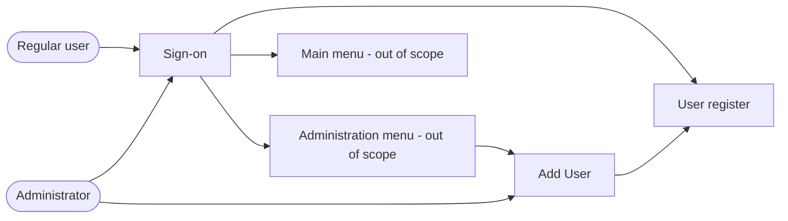
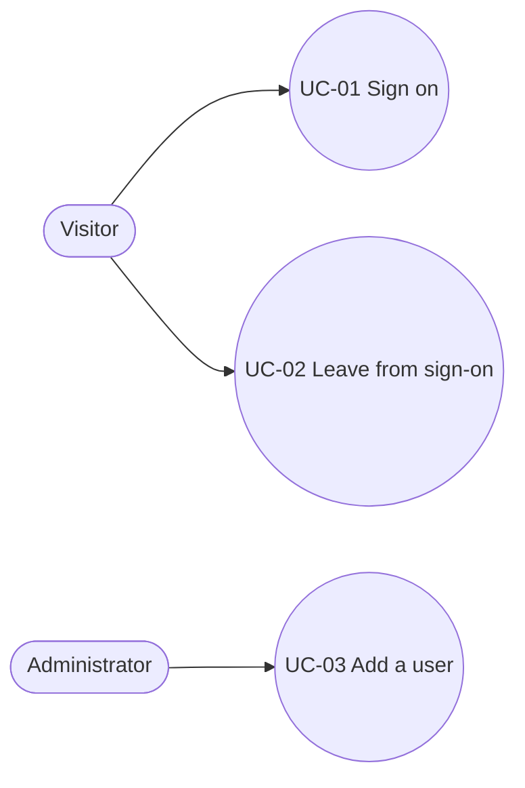
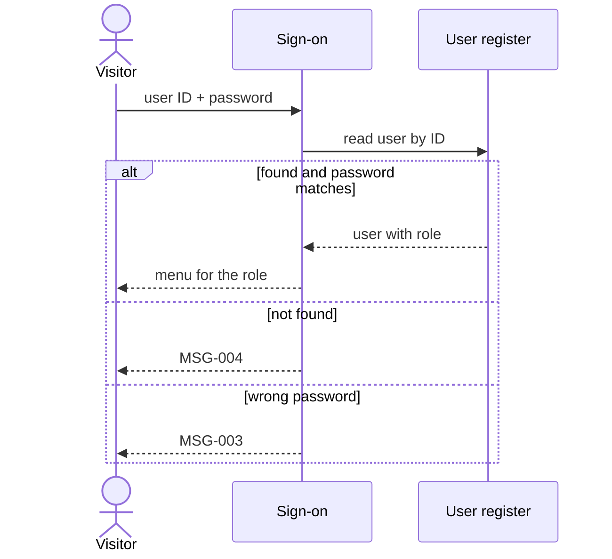
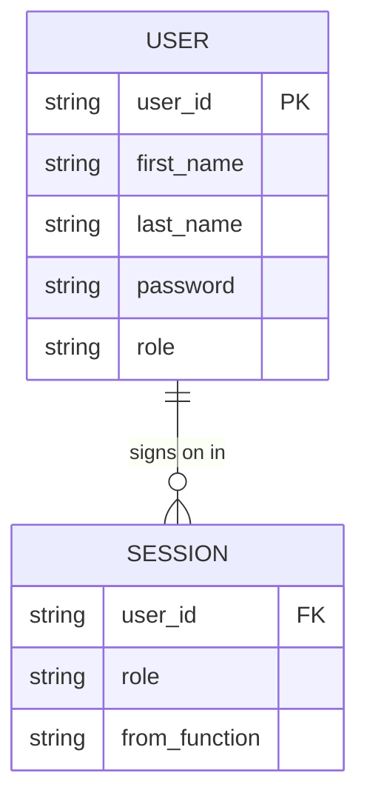
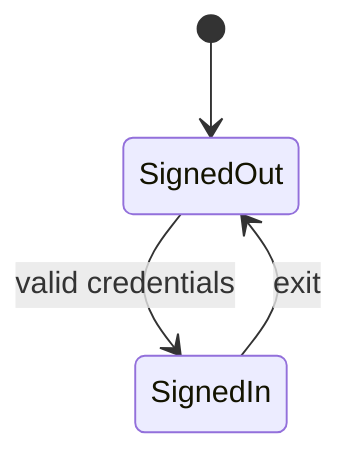
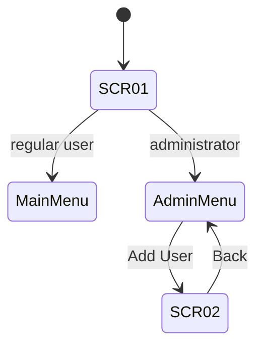

# CardDemo: Sign-on and Add User: Functional Requirements Document (FRD)

<!-- WHAT the solution must do: behaviour visible to users and other systems, independent of how it is built.
Every FR traces to at least one BR in the upstream BRD (derived_from).
IDs: UC-nn use case, FR-nnn functional requirement, SCR-nn screen, BAT-nn batch function, RPT-nn report,
INT-nn interface, MSG-nnn message. "N/A: <reason>" for sections that do not apply; "Unknown" for missing facts. -->

## 1. Document Control

### 1.1 Document Information

| Field | Value |
|---|---|
| Purpose | Specifies the functional behaviour of sign-on and Add User in CardDemo |
| Owner | Demo owner |
| Version / date | see front matter and 1.2 |
| Approval status | Draft |
| Upstream documents | see 1.4 |

### 1.2 Revision History

| Version | Date | Author | Change summary | Sections changed |
|---|---|---|---|---|
| 0.1.0 | 2026-11-05 | Claude (draft) | Initial draft | All |

### 1.3 Approvals

| Role | Name | Decision | Date |
|---|---|---|---|
| Product Owner | Unknown | Pending | |
| Business Analyst Lead | Unknown | Pending | |
| QA Lead | Unknown | Pending | |

### 1.4 Upstream Documents

- BRD-USER-ADMIN-SIGN-ON 0.1.0 (`BRD.md`).

## 2. Product Overview and Scope

Two functions: a user signs on and is sent to the menu for their role; an administrator adds a user. Both read or write
the user register. Scope and exclusions follow BRD §9.

## 3. User Roles, Actors and Permissions

| Actor / Role | Description | Legacy equivalent | Permissions |
|---|---|---|---|
| Anonymous visitor | Not yet signed on | No session data | Sign-on only |
| Regular user | Signed-on staff member | User type U | Main menu functions |
| Administrator | Signed-on staff member who manages users | User type A | Administration menu, Add User |

## 4. User Journeys and Use Cases

### UC-01: Sign on
- **Actor(s):** Visitor  **Traces to:** BR-001, BR-002
- **Preconditions:** The visitor has a user ID in the register.  **Trigger:** The visitor opens CardDemo.
- **Main flow:** 1. The system shows the sign-on screen. 2. The visitor enters user ID and password and submits. 3. The system checks the register. 4. The system opens the menu for the user's role.
- **Alternate and error flows:** 2a. A field is empty: MSG-001 or MSG-002, focus on that field. 3a. User ID unknown: MSG-004. 3b. Password wrong: MSG-003. 3c. Register unavailable: MSG-005.
- **Postconditions:** A session records the user ID and role.

### UC-02: Leave from sign-on
- **Actor(s):** Visitor  **Traces to:** BR-001
- **Preconditions:** The sign-on screen is shown.  **Trigger:** The visitor chooses Exit.
- **Main flow:** 1. The system shows a thank-you message and ends the conversation.
- **Alternate and error flows:** none.
- **Postconditions:** No session exists.

### UC-03: Add a user
- **Actor(s):** Administrator  **Traces to:** BR-003, BR-004
- **Preconditions:** The administrator is signed on.  **Trigger:** The administrator chooses Add User.
- **Main flow:** 1. The system shows an empty Add User form. 2. The administrator enters first name, last name, user ID, password and type and submits. 3. The system saves the user and shows MSG-011 with the user ID, with an empty form.
- **Alternate and error flows:** 2a. A field is empty: the matching message MSG-006 to MSG-010. 3a. User ID exists: MSG-012. 3b. Save fails: MSG-013. 2b. Clear: the form empties. 2c. Back: the administration menu opens.
- **Postconditions:** The user is in the register.

## 5. Functional Requirements

### Sign-on

#### FR-001: Require both credentials
- **Description:** The system shall refuse a sign-on with an empty user ID or an empty password without checking the register.
- **Traces to:** BR-001, RUL-001
- **Priority:** Unknown
- **Actor:** Visitor
- **Preconditions:** Sign-on screen shown.
- **Main flow:** 1. The visitor submits. 2. The system checks user ID, then password, for presence.
- **Alternate and error flows:** 2a. User ID empty: MSG-001. 2b. Password empty: MSG-002.
- **Business rules:** RUL-001
- **Acceptance criteria:**
  - Given an empty user ID, When the visitor submits, Then MSG-001 is shown and the cursor is on the user ID.
  - Given a user ID and an empty password, When the visitor submits, Then MSG-002 is shown and the cursor is on the password.
- **Basis:** Derived from code (candidate)
- **Legacy reference:** [`cbl/COSGN00C.cbl:117-130`](https://github.com/aws-samples/aws-mainframe-modernization-carddemo/blob/59cc6c2fd7ebd7ef7925cad552a01a4b8b6e4d5e/app/cbl/COSGN00C.cbl#L117-L130) paragraph PROCESS-ENTER-KEY

#### FR-002: Verify credentials against the register
- **Description:** The system shall sign the visitor on when the user ID exists and the password matches, and otherwise say whether the user is unknown or the password is wrong.
- **Traces to:** BR-001, RUL-002, RUL-003
- **Priority:** Unknown
- **Actor:** Visitor
- **Preconditions:** Both credentials entered.
- **Main flow:** 1. The system looks up the user ID. 2. The system compares the password. 3. Sign-on succeeds.
- **Alternate and error flows:** 1a. Not found: MSG-004. 1b. Register unavailable: MSG-005. 2a. Mismatch: MSG-003.
- **Business rules:** RUL-002, RUL-003
- **Acceptance criteria:**
  - Given user USER0001 in the register, When the visitor enters USER0001 and its password, Then the main menu opens.
  - Given no user NOBODY01, When the visitor enters NOBODY01, Then MSG-004 is shown.
- **Basis:** Derived from code (candidate)
- **Legacy reference:** [`cbl/COSGN00C.cbl:209-257`](https://github.com/aws-samples/aws-mainframe-modernization-carddemo/blob/59cc6c2fd7ebd7ef7925cad552a01a4b8b6e4d5e/app/cbl/COSGN00C.cbl#L209-L257) paragraph READ-USER-SEC-FILE. Deliberate change pending Q-02: the case rule for passwords (today upper-cased before comparing, [`cbl/COSGN00C.cbl:132-136`](https://github.com/aws-samples/aws-mainframe-modernization-carddemo/blob/59cc6c2fd7ebd7ef7925cad552a01a4b8b6e4d5e/app/cbl/COSGN00C.cbl#L132-L136)).

#### FR-003: Open the menu for the user's role
- **Description:** The system shall open the administration menu for an administrator and the main menu for a regular user, and record the user ID and role in the session.
- **Traces to:** BR-002, RUL-004
- **Priority:** Unknown
- **Actor:** Visitor
- **Preconditions:** FR-002 succeeded.
- **Main flow:** 1. The system reads the role. 2. The system opens the matching menu.
- **Alternate and error flows:** none.
- **Business rules:** RUL-004
- **Acceptance criteria:**
  - Given ADMIN001 signs on, Then the administration menu opens.
  - Given USER0001 signs on, Then the main menu opens.
- **Basis:** Derived from code (candidate)
- **Legacy reference:** [`cbl/COSGN00C.cbl:224-240`](https://github.com/aws-samples/aws-mainframe-modernization-carddemo/blob/59cc6c2fd7ebd7ef7925cad552a01a4b8b6e4d5e/app/cbl/COSGN00C.cbl#L224-L240) paragraph READ-USER-SEC-FILE

#### FR-004: Leave from the sign-on screen
- **Description:** The system shall end the conversation with a thank-you message when the visitor chooses Exit on the sign-on screen.
- **Traces to:** BR-001
- **Priority:** Unknown
- **Actor:** Visitor
- **Preconditions:** Sign-on screen shown.
- **Main flow:** 1. The visitor chooses Exit. 2. MSG-014 is shown.
- **Alternate and error flows:** Any other unassigned key: MSG-015.
- **Business rules:** none
- **Acceptance criteria:**
  - Given the sign-on screen, When the visitor chooses Exit, Then MSG-014 is shown and no session exists.
- **Basis:** Derived from code (candidate)
- **Legacy reference:** [`cbl/COSGN00C.cbl:85-95`](https://github.com/aws-samples/aws-mainframe-modernization-carddemo/blob/59cc6c2fd7ebd7ef7925cad552a01a4b8b6e4d5e/app/cbl/COSGN00C.cbl#L85-L95) paragraph MAIN-PARA

### Add User

#### FR-005: Require all user details
- **Description:** The system shall refuse to add a user unless first name, last name, user ID, password and type are all entered, reporting the first missing one.
- **Traces to:** BR-003, RUL-005
- **Priority:** Unknown
- **Actor:** Administrator
- **Preconditions:** Add User form shown.
- **Main flow:** 1. The administrator submits. 2. The system checks the fields in form order.
- **Alternate and error flows:** 2a. First missing field: MSG-006 to MSG-010 with focus on it.
- **Business rules:** RUL-005
- **Acceptance criteria:**
  - Given every field but last name, When the administrator submits, Then MSG-007 is shown and nothing is saved.
- **Basis:** Derived from code (candidate)
- **Legacy reference:** [`cbl/COUSR01C.cbl:117-151`](https://github.com/aws-samples/aws-mainframe-modernization-carddemo/blob/59cc6c2fd7ebd7ef7925cad552a01a4b8b6e4d5e/app/cbl/COUSR01C.cbl#L117-L151) paragraph PROCESS-ENTER-KEY

#### FR-006: Accept only the two roles
- **Description:** The system shall accept a user type of Administrator or Regular user only.
- **Traces to:** BR-003, RUL-006
- **Priority:** Unknown
- **Actor:** Administrator
- **Preconditions:** All fields entered.
- **Main flow:** 1. The system checks the type.
- **Alternate and error flows:** 1a. Any other value: MSG-016 and nothing is saved.
- **Business rules:** RUL-006
- **Acceptance criteria:**
  - Given type X, When the administrator submits, Then MSG-016 is shown and nothing is saved.
- **Basis:** Proposed
- **Legacy reference:** [`cbl/COUSR01C.cbl:142-147`](https://github.com/aws-samples/aws-mainframe-modernization-carddemo/blob/59cc6c2fd7ebd7ef7925cad552a01a4b8b6e4d5e/app/cbl/COUSR01C.cbl#L142-L147). Deliberate change: today any character is saved.

#### FR-007: Save a new user with a unique user ID
- **Description:** The system shall save the user and confirm with the user ID, or refuse when the user ID exists.
- **Traces to:** BR-003, RUL-007
- **Priority:** Unknown
- **Actor:** Administrator
- **Preconditions:** FR-005 and FR-006 passed.
- **Main flow:** 1. The system saves the user. 2. The form empties and MSG-011 names the user.
- **Alternate and error flows:** 1a. User ID exists: MSG-012. 1b. Save fails: MSG-013.
- **Business rules:** RUL-007
- **Acceptance criteria:**
  - Given user ID NEWUSER1 is free, When the administrator submits a complete form, Then MSG-011 names NEWUSER1.
  - Given user ID ADMIN001 exists, When the administrator submits it, Then MSG-012 is shown.
- **Basis:** Derived from code (candidate)
- **Legacy reference:** [`cbl/COUSR01C.cbl:238-274`](https://github.com/aws-samples/aws-mainframe-modernization-carddemo/blob/59cc6c2fd7ebd7ef7925cad552a01a4b8b6e4d5e/app/cbl/COUSR01C.cbl#L238-L274) paragraph WRITE-USER-SEC-FILE

#### FR-008: New credentials sign on as entered
- **Description:** The system shall store a new user's user ID and password so that signing on with exactly what the administrator entered succeeds.
- **Traces to:** BR-004, RUL-003
- **Priority:** Unknown
- **Actor:** Administrator
- **Preconditions:** FR-007 saved the user.
- **Main flow:** 1. The new user signs on with the entered credentials. 2. Sign-on succeeds.
- **Alternate and error flows:** none.
- **Business rules:** RUL-003
- **Acceptance criteria:**
  - Given an administrator added newuser2 with password secret12, When that user signs on with newuser2 and secret12, Then sign-on succeeds.
- **Basis:** Proposed
- **Legacy reference:** Deliberate change: today [`cbl/COUSR01C.cbl:154-158`](https://github.com/aws-samples/aws-mainframe-modernization-carddemo/blob/59cc6c2fd7ebd7ef7925cad552a01a4b8b6e4d5e/app/cbl/COUSR01C.cbl#L154-L158) saves as typed and [`cbl/COSGN00C.cbl:132-136`](https://github.com/aws-samples/aws-mainframe-modernization-carddemo/blob/59cc6c2fd7ebd7ef7925cad552a01a4b8b6e4d5e/app/cbl/COSGN00C.cbl#L132-L136) compares upper case, so this case fails.

#### FR-009: Clear the form and go back
- **Description:** The system shall empty the Add User form on Clear and open the administration menu on Back.
- **Traces to:** BR-003
- **Priority:** Unknown
- **Actor:** Administrator
- **Preconditions:** Add User form shown.
- **Main flow:** 1. Clear empties every field. 2. Back opens the administration menu.
- **Alternate and error flows:** Any other unassigned key: MSG-015.
- **Business rules:** none
- **Acceptance criteria:**
  - Given a filled form, When the administrator chooses Clear, Then every field is empty and nothing is saved.
- **Basis:** Derived from code (candidate)
- **Legacy reference:** [`cbl/COUSR01C.cbl:90-103`](https://github.com/aws-samples/aws-mainframe-modernization-carddemo/blob/59cc6c2fd7ebd7ef7925cad552a01a4b8b6e4d5e/app/cbl/COUSR01C.cbl#L90-L103) paragraph MAIN-PARA, [`cbl/COUSR01C.cbl:279-295`](https://github.com/aws-samples/aws-mainframe-modernization-carddemo/blob/59cc6c2fd7ebd7ef7925cad552a01a4b8b6e4d5e/app/cbl/COUSR01C.cbl#L279-L295)

#### FR-010: Migrate existing users
- **Description:** The system shall hold every user from the legacy register with the same user ID, names and role at cutover.
- **Traces to:** BR-005
- **Priority:** Unknown
- **Actor:** Migration
- **Preconditions:** Cutover.
- **Main flow:** 1. Every legacy user is loaded. 2. Counts match.
- **Alternate and error flows:** 1a. A type other than A or U: reported for an SME decision.
- **Business rules:** RUL-006
- **Acceptance criteria:**
  - Given the legacy register with N users, When migration completes, Then the new register has N users with the same IDs and roles.
- **Basis:** Proposed
- **Legacy reference:** [`cpy/CSUSR01Y.cpy:17-23`](https://github.com/aws-samples/aws-mainframe-modernization-carddemo/blob/59cc6c2fd7ebd7ef7925cad552a01a4b8b6e4d5e/app/cpy/CSUSR01Y.cpy#L17-L23)

## 6. Data Inputs, Outputs, Validation and States

### 6.1 Logical Data Model

### 6.2 Inputs, Outputs and Validation Rules

| Field | Length | Required | Validation | Source |
|---|---|---|---|---|
| User ID | 8 | Yes | Unique (RUL-007) | [`cpy/CSUSR01Y.cpy:18`](https://github.com/aws-samples/aws-mainframe-modernization-carddemo/blob/59cc6c2fd7ebd7ef7925cad552a01a4b8b6e4d5e/app/cpy/CSUSR01Y.cpy#L18) |
| First name | 20 | Yes | none | [`cpy/CSUSR01Y.cpy:19`](https://github.com/aws-samples/aws-mainframe-modernization-carddemo/blob/59cc6c2fd7ebd7ef7925cad552a01a4b8b6e4d5e/app/cpy/CSUSR01Y.cpy#L19) |
| Last name | 20 | Yes | none | [`cpy/CSUSR01Y.cpy:20`](https://github.com/aws-samples/aws-mainframe-modernization-carddemo/blob/59cc6c2fd7ebd7ef7925cad552a01a4b8b6e4d5e/app/cpy/CSUSR01Y.cpy#L20) |
| Password | 8 | Yes | Policy per Q-02 | [`cpy/CSUSR01Y.cpy:21`](https://github.com/aws-samples/aws-mainframe-modernization-carddemo/blob/59cc6c2fd7ebd7ef7925cad552a01a4b8b6e4d5e/app/cpy/CSUSR01Y.cpy#L21) |
| User type | 1 | Yes | A or U (RUL-006) | [`cpy/CSUSR01Y.cpy:22`](https://github.com/aws-samples/aws-mainframe-modernization-carddemo/blob/59cc6c2fd7ebd7ef7925cad552a01a4b8b6e4d5e/app/cpy/CSUSR01Y.cpy#L22) |

### 6.3 User-Visible States

### 6.4 CRUD Matrix (function × entity)

| Function | User |
|---|---|
| Sign-on (FR-002) | R |
| Add User (FR-007) | C |

## 7. User Interface and Accessibility Requirements

### SCR-01: Sign-on
- Purpose: identify the user. Navigation in: start of the application. Out: menu for the role, or exit.
- Fields: User ID (8, required, focus first), Password (8, required, masked). Legacy map [`bms/COSGN00.bms:155-189`](https://github.com/aws-samples/aws-mainframe-modernization-carddemo/blob/59cc6c2fd7ebd7ef7925cad552a01a4b8b6e4d5e/app/bms/COSGN00.bms#L155-L189).
- Actions: Enter → Sign on; F3 → Exit.

### SCR-02: Add User
- Purpose: add one user. Navigation in: administration menu. Out: administration menu.
- Fields: First name (20), Last name (20), User ID (8), Password (8, masked), User type (A or U). Legacy map [`bms/COUSR01.bms:79-159`](https://github.com/aws-samples/aws-mainframe-modernization-carddemo/blob/59cc6c2fd7ebd7ef7925cad552a01a4b8b6e4d5e/app/bms/COUSR01.bms#L79-L159).
- Actions: Enter → Add; F3 → Back; F4 → Clear. The legacy label also shows F12=Exit, which the program does not handle (Q-07).

Accessibility: WCAG 2.2 AA is proposed (Q-08); every field has a visible label and the error message is announced.

## 8. Search, Reporting, Notifications and Exports

N/A: neither function searches, reports, notifies or exports.

## 9. Batch and Scheduled Processing

N/A: the slice has no batch function. Loading the register (DUSRSECJ) is out of scope (BRD §9.2).

## 10. Integrations and External System Behavior

N/A: no external system is called. Single sign-on is a future consideration (BRD Q-04).

## 11. Authentication, Authorization and Audit Behavior

| Function | Visitor | Regular user | Administrator |
|---|---|---|---|
| Sign-on | Yes | Yes | Yes |
| Add User | No | No | Yes |

- Lockout after failed attempts: none today; the new behaviour depends on BRD Q-03.
- Add User is reached from the administration menu; the program does not itself check the caller's role (Q-09).
- Audit: nothing is recorded today; whether sign-ons and user creation are audited is Unknown (Q-10).

## 12. Error Handling and Recovery

| ID | Condition | Message text | Severity | User recovery | Legacy source |
|---|---|---|---|---|---|
| MSG-001 | User ID empty | Please enter User ID ... | Error | Enter the user ID | [`cbl/COSGN00C.cbl:120`](https://github.com/aws-samples/aws-mainframe-modernization-carddemo/blob/59cc6c2fd7ebd7ef7925cad552a01a4b8b6e4d5e/app/cbl/COSGN00C.cbl#L120) |
| MSG-002 | Password empty | Please enter Password ... | Error | Enter the password | [`cbl/COSGN00C.cbl:125`](https://github.com/aws-samples/aws-mainframe-modernization-carddemo/blob/59cc6c2fd7ebd7ef7925cad552a01a4b8b6e4d5e/app/cbl/COSGN00C.cbl#L125) |
| MSG-003 | Wrong password | Wrong Password. Try again ... | Error | Re-enter the password | [`cbl/COSGN00C.cbl:242`](https://github.com/aws-samples/aws-mainframe-modernization-carddemo/blob/59cc6c2fd7ebd7ef7925cad552a01a4b8b6e4d5e/app/cbl/COSGN00C.cbl#L242) |
| MSG-004 | Unknown user ID | User not found. Try again ... | Error | Re-enter the user ID | [`cbl/COSGN00C.cbl:249`](https://github.com/aws-samples/aws-mainframe-modernization-carddemo/blob/59cc6c2fd7ebd7ef7925cad552a01a4b8b6e4d5e/app/cbl/COSGN00C.cbl#L249) |
| MSG-005 | Register unavailable | Unable to verify the User ... | Error | Try later | [`cbl/COSGN00C.cbl:254`](https://github.com/aws-samples/aws-mainframe-modernization-carddemo/blob/59cc6c2fd7ebd7ef7925cad552a01a4b8b6e4d5e/app/cbl/COSGN00C.cbl#L254) |
| MSG-006 | First name empty | First Name can NOT be empty... | Error | Enter it | [`cbl/COUSR01C.cbl:120`](https://github.com/aws-samples/aws-mainframe-modernization-carddemo/blob/59cc6c2fd7ebd7ef7925cad552a01a4b8b6e4d5e/app/cbl/COUSR01C.cbl#L120) |
| MSG-007 | Last name empty | Last Name can NOT be empty... | Error | Enter it | [`cbl/COUSR01C.cbl:126`](https://github.com/aws-samples/aws-mainframe-modernization-carddemo/blob/59cc6c2fd7ebd7ef7925cad552a01a4b8b6e4d5e/app/cbl/COUSR01C.cbl#L126) |
| MSG-008 | User ID empty | User ID can NOT be empty... | Error | Enter it | [`cbl/COUSR01C.cbl:132`](https://github.com/aws-samples/aws-mainframe-modernization-carddemo/blob/59cc6c2fd7ebd7ef7925cad552a01a4b8b6e4d5e/app/cbl/COUSR01C.cbl#L132) |
| MSG-009 | Password empty | Password can NOT be empty... | Error | Enter it | [`cbl/COUSR01C.cbl:138`](https://github.com/aws-samples/aws-mainframe-modernization-carddemo/blob/59cc6c2fd7ebd7ef7925cad552a01a4b8b6e4d5e/app/cbl/COUSR01C.cbl#L138) |
| MSG-010 | User type empty | User Type can NOT be empty... | Error | Enter it | [`cbl/COUSR01C.cbl:144`](https://github.com/aws-samples/aws-mainframe-modernization-carddemo/blob/59cc6c2fd7ebd7ef7925cad552a01a4b8b6e4d5e/app/cbl/COUSR01C.cbl#L144) |
| MSG-011 | User saved | User <id> has been added ... | Info | none | [`cbl/COUSR01C.cbl:255-257`](https://github.com/aws-samples/aws-mainframe-modernization-carddemo/blob/59cc6c2fd7ebd7ef7925cad552a01a4b8b6e4d5e/app/cbl/COUSR01C.cbl#L255-L257) |
| MSG-012 | User ID exists | User ID already exist... | Error | Choose another ID | [`cbl/COUSR01C.cbl:263`](https://github.com/aws-samples/aws-mainframe-modernization-carddemo/blob/59cc6c2fd7ebd7ef7925cad552a01a4b8b6e4d5e/app/cbl/COUSR01C.cbl#L263) |
| MSG-013 | Save failed | Unable to Add User... | Error | Try later | [`cbl/COUSR01C.cbl:270`](https://github.com/aws-samples/aws-mainframe-modernization-carddemo/blob/59cc6c2fd7ebd7ef7925cad552a01a4b8b6e4d5e/app/cbl/COUSR01C.cbl#L270) |
| MSG-014 | Exit from sign-on | Thank-you message | Info | none | [`cbl/COSGN00C.cbl:89`](https://github.com/aws-samples/aws-mainframe-modernization-carddemo/blob/59cc6c2fd7ebd7ef7925cad552a01a4b8b6e4d5e/app/cbl/COSGN00C.cbl#L89) |
| MSG-015 | Unassigned key | Invalid key message | Error | Use a listed key | [`cbl/COSGN00C.cbl:93`](https://github.com/aws-samples/aws-mainframe-modernization-carddemo/blob/59cc6c2fd7ebd7ef7925cad552a01a4b8b6e4d5e/app/cbl/COSGN00C.cbl#L93) |
| MSG-016 | Type not A or U | Unknown (new message, wording to agree) | Error | Enter A or U | none (new, FR-006) |

## 13. Functional Dependencies and Assumptions

- The administration and main menus exist (BRD DEP-01).
- Seed users from the legacy load job are available for acceptance tests (BRD ASM-02).

## 14. Acceptance and Verification Criteria

- Functional equivalence: the same credentials give the same outcome (signed on to the same menu, or the same message) in
  legacy and new systems for the ten seed users and for unknown IDs, except for deliberate changes FR-006 and FR-008.
- Each FR's Given/When/Then is an automated test.

## 15. Open Questions and Decisions Needed

| # | Question / decision | Owner | Due | Answer / decision |
|---|---|---|---|---|
| Q-07 | Should Add User offer Exit (F12 on the legacy screen) and what does it do? | Product Owner | Unknown | |
| Q-08 | Is WCAG 2.2 AA the accessibility target? | Product Owner | Unknown | |
| Q-09 | Must Add User check that the caller is an administrator itself, not only through the menu? | Security Officer | Unknown | |
| Q-10 | Are sign-ons and user creation audited, and who reads the audit? | Security Officer | Unknown | |

## 16. Glossary

| Term | Definition |
|---|---|
| Register | The stored list of users (BRD §20) |
| Session | What the system remembers about a signed-on user |

## 17. Appendices

### 17.1 Traceability Matrix

<!-- trace:begin -->
| FR | Requirement | Business reqs | SRD items |
|---|---|---|---|
| FR-001 | Require both credentials | BR-001 | SR-001 |
| FR-002 | Verify credentials against the register | BR-001 | IFR-001, SR-002 |
| FR-003 | Open the menu for the user's role | BR-002 | IFR-001, SR-003 |
| FR-004 | Leave from the sign-on screen | BR-001 | SR-003 |
| FR-005 | Require all user details | BR-003 | SR-004 |
| FR-006 | Accept only the two roles | BR-003 | DR-001, SR-004 |
| FR-007 | Save a new user with a unique user ID | BR-003 | DR-001, IFR-002, SR-004, SR-006 |
| FR-008 | New credentials sign on as entered | BR-004 | SR-005 |
| FR-009 | Clear the form and go back | BR-003 | SR-008 |
| FR-010 | Migrate existing users | BR-005 | SR-007 |

Coverage: 5/5 BRs have FRs; 10/10 FRs have SRD items. Generated by docver.py trace.
<!-- trace:end -->
