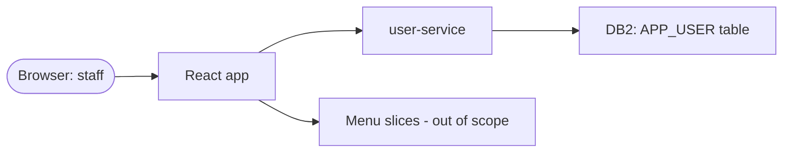
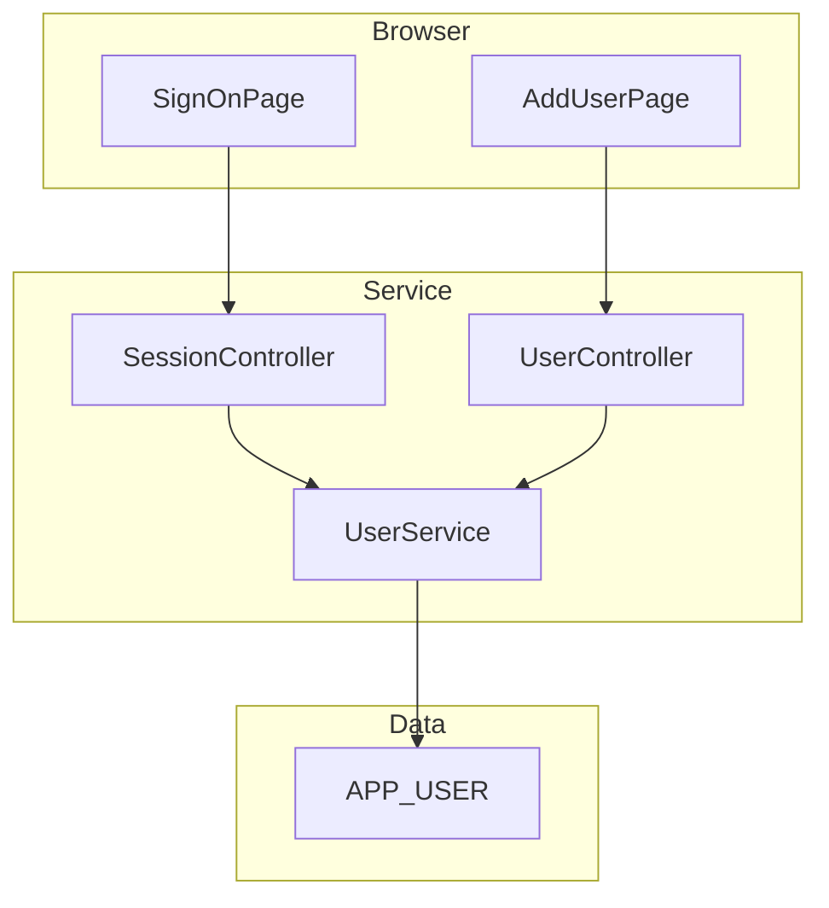
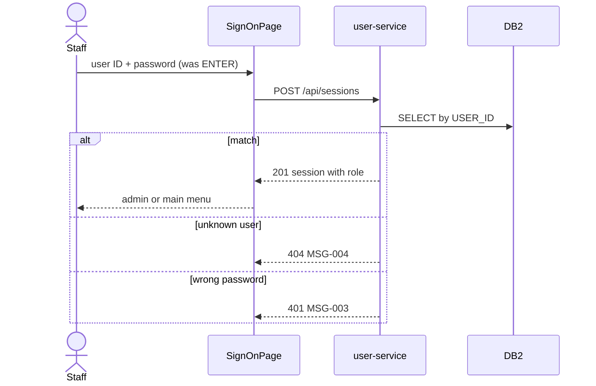
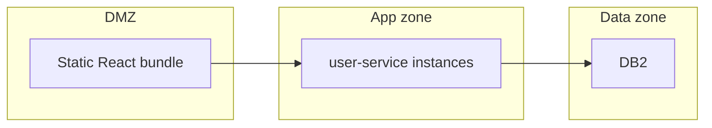
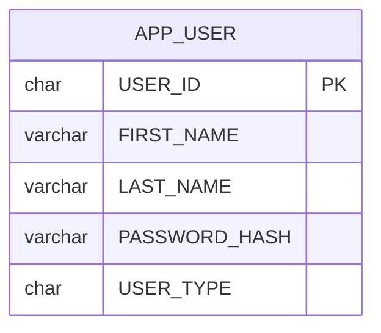
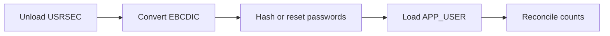

# CardDemo: Sign-on and Add User: System Requirements Document (SRD)

<!-- Structure basis: ISO/IEC/IEEE 29148 (system/software requirements content), extended with runtime, operations,
CI/CD and legacy-to-target sections for modernization. HOW the system must behave technically and the constraints on it.
IDs: SR-nnn system requirement, NFR-nnn quality requirement, IFR-nnn interface, DR-nnn data, ADR-nn decision.
SR traces to FR; NFR/IFR/DR trace to BR/FR/RUL or say "Traces to: technical (<reason>)".
Unknown targets: "TBD (decision needed: ..., owner: ...)". Never invent SLOs, capacities or security guarantees. -->

## 1. Document Control

### 1.1 Document Information

| Field | Value |
|---|---|
| Purpose | Specifies the system requirements and constraints for sign-on and Add User in CardDemo |
| Owner | Demo owner |
| Version / date | see front matter and 1.2 |
| Approval status | Draft |
| Upstream documents | see 1.4 |

### 1.2 Revision History

| Version | Date | Author | Change summary | Sections changed |
|---|---|---|---|---|
| 0.1.0 | 2026-11-05 | Claude (draft) | Initial draft | All |

### 1.3 Approvals

| Role | Name | Decision | Date |
|---|---|---|---|
| Solution Architect | Unknown | Pending | |
| Engineering Lead | Unknown | Pending | |
| Security | Unknown | Pending | |
| DBA / Data Architect | Unknown | Pending | |

### 1.4 Upstream Documents

- FRD-USER-ADMIN-SIGN-ON 0.1.0 (`FRD.md`), BRD-USER-ADMIN-SIGN-ON 0.1.0 (`BRD.md`).
- Mapping drafts: `l2m map --programs COSGN00C COUSR01C` (target-mapping.md, data-mapping.md in the analysis folder).

## 2. System Scope, Context, Actors and External Dependencies

The slice is a React single-page application and one Spring Boot service over one DB2 table. It replaces two CICS
programs and the USRSEC VSAM file. The menus it hands over to are other slices.

## 3. Architecture Overview and Major Components

| Component | Responsibility | FRs realized |
|---|---|---|
| `SignOnPage` (React) | Sign-on form, messages, routing by role | FR-001, FR-003, FR-004 |
| `AddUserPage` (React) | Add User form, clear, back | FR-005, FR-006, FR-009 |
| user-service (Spring Boot) | Credential check, session, user creation | FR-002, FR-007, FR-008 |
| Migration job | One-off load of the legacy register | FR-010 |

## 4. Runtime, Hosting, Environments and Deployment Topology

- Runtime versions: Java, Spring Boot, React and DB2 edition: TBD (decision needed: platform baseline, owner: Solution Architect).
- Hosting and environments: Unknown (Q-11).

## 5. System Requirements

### user-service

### SR-001: Reject incomplete sign-on requests
- **Requirement:** The user-service shall answer 400 with MSG-001 or MSG-002 when the user ID or password is empty, without reading APP_USER.
- **Traces to:** FR-001
- **Component:** user-service
- **Priority:** Unknown
- **Verification:** Test
- **Basis:** Derived from code (candidate)
- **Notes:** Replaces the presence checks in PROCESS-ENTER-KEY of COSGN00C.

### SR-002: Check credentials against APP_USER
- **Requirement:** The user-service shall read APP_USER by user ID and verify the password against the stored hash, answering 404 (MSG-004) for an unknown user, 401 (MSG-003) for a wrong password and 503 (MSG-005) when DB2 is unavailable.
- **Traces to:** FR-002
- **Component:** user-service
- **Priority:** Unknown
- **Verification:** Test
- **Basis:** Derived from code (candidate)
- **Notes:** Replaces the USRSEC READ and its RESP handling (NORMAL, NOTFND=13, other). Whether 404/401 stay distinguishable is a security decision (Q-12).

### SR-003: Issue a session carrying the role
- **Requirement:** The user-service shall create a session holding user ID and role on success, and the React app shall open the administration menu for role A and the main menu for role U.
- **Traces to:** FR-003, FR-004
- **Component:** user-service, SignOnPage
- **Priority:** Unknown
- **Verification:** Test
- **Basis:** Derived from code (candidate)
- **Notes:** Replaces CARDDEMO-COMMAREA (CDEMO-USER-ID, CDEMO-USER-TYPE) and the XCTL to COADM01C or COMEN01C.

### SR-004: Create users with validation
- **Requirement:** The user-service shall create an APP_USER row only when all five fields are present and the role is A or U, answering 400 with MSG-006 to MSG-010 or MSG-016 otherwise, and 409 (MSG-012) on a duplicate user ID.
- **Traces to:** FR-005, FR-006, FR-007
- **Component:** user-service, AddUserPage
- **Priority:** Unknown
- **Verification:** Test
- **Basis:** Derived from code (candidate)
- **Notes:** Replaces WRITE-USER-SEC-FILE (DUPKEY/DUPREC → 409). The role check is new (FR-006).

### SR-005: Store credentials under one normalisation rule
- **Requirement:** The user-service shall apply the same user ID and password normalisation when creating a user and when checking a sign-on, so a user signs on with exactly what was entered.
- **Traces to:** FR-008
- **Component:** user-service
- **Priority:** Unknown
- **Verification:** Test
- **Basis:** Proposed
- **Notes:** Which rule (case-sensitive or not) depends on BRD Q-02.

### SR-006: Restrict user creation to administrators
- **Requirement:** The user-service shall refuse user creation with 403 unless the session role is A.
- **Traces to:** FR-007
- **Component:** user-service
- **Priority:** Unknown
- **Verification:** Test
- **Basis:** Proposed
- **Notes:** The legacy program relies on menu navigation only (FRD Q-09).

### SR-007: Load the legacy register
- **Requirement:** The migration job shall load every USRSEC record into APP_USER and report the counts and any record with a type other than A or U.
- **Traces to:** FR-010
- **Component:** Migration job
- **Priority:** Unknown
- **Verification:** Test
- **Basis:** Proposed
- **Notes:** See §7.3.

### SR-008: Clear and back are client-only
- **Requirement:** The AddUserPage shall clear its fields and navigate back to the administration menu without calling the service.
- **Traces to:** FR-009
- **Component:** AddUserPage
- **Priority:** Unknown
- **Verification:** Demonstration
- **Basis:** Derived from code (candidate)
- **Notes:** Replaces the F4 and F3 branches of COUSR01C.

## 6. Interfaces, APIs, Events and Integration Contracts

### IFR-001: Session API
- **Interface:** `POST /api/sessions` with `{userId, password}` → 201 `{userId, role}`; errors 400, 401, 404, 503 with a message ID.
- **Traces to:** FR-002, FR-003
- **Basis:** Proposed

### IFR-002: User creation API
- **Interface:** `POST /api/users` with `{userId, firstName, lastName, password, role}` → 201 `{userId}`; errors 400, 403, 409, 503 with a message ID.
- **Traces to:** FR-007
- **Basis:** Proposed

## 7. Data Entities, Storage, Lifecycle, Migration, Backup and Retention

### 7.1 Physical Data Model

### DR-001: APP_USER table
- **Data requirement:** APP_USER has USER_ID CHAR(8) primary key, FIRST_NAME and LAST_NAME VARCHAR(20) NOT NULL, PASSWORD_HASH (length per the chosen algorithm), USER_TYPE CHAR(1) NOT NULL with a check for A or U.
- **Traces to:** FR-006, FR-007, RUL-007
- **Basis:** Proposed

### 7.2 Legacy-to-Target Data Mapping

| Legacy field | Legacy type | Target column | Rule |
|---|---|---|---|
| SEC-USR-ID | X(08) | USER_ID CHAR(8) | Key; normalised per SR-005 |
| SEC-USR-FNAME | X(20) | FIRST_NAME VARCHAR(20) | Trim trailing spaces |
| SEC-USR-LNAME | X(20) | LAST_NAME VARCHAR(20) | Trim trailing spaces |
| SEC-USR-PWD | X(08) | PASSWORD_HASH | Never copied in clear; see §7.3 and Q-02 |
| SEC-USR-TYPE | X(01) | USER_TYPE CHAR(1) | A or U; other values reported |
| SEC-USR-FILLER | X(23) | none | Dropped (unused) |

Source: [`cpy/CSUSR01Y.cpy:17-23`](https://github.com/aws-samples/aws-mainframe-modernization-carddemo/blob/59cc6c2fd7ebd7ef7925cad552a01a4b8b6e4d5e/app/cpy/CSUSR01Y.cpy#L17-L23). The mechanical draft (one column per field, `CSUSR01Y` as table name) is in the
analysis folder's data-mapping.md; the rows above rename it and drop the filler.

### 7.3 Data Migration and Reconciliation

Unload USRSEC, convert EBCDIC to Unicode, load APP_USER, and reconcile row counts and user IDs. Passwords are hashed
during load, or reset, per Q-02.

### 7.4 Backup, Retention and Archival

Retention: Unknown (BRD Q-05). Backup follows the platform standard: Unknown (Q-11).

## 8. Identity, Authentication, Authorization, Secrets and Security

### NFR-001: Passwords are never stored readable
- **Requirement:** The user-service shall store only a salted one-way hash of each password.
- **Traces to:** BR-001
- **Basis:** Proposed

### NFR-002: Failed sign-on limit
- **Requirement:** The user-service shall lock an account after TBD (decision needed: attempt limit, owner: Security Officer) failed sign-ons.
- **Traces to:** BR-001
- **Basis:** Proposed

## 9. Privacy and Data Protection

Staff names and credentials are personal data. Retention and access to them follow BRD §16 (Unknown).

## 10. Performance, Capacity and Scalability

### NFR-003: Sign-on response time
- **Requirement:** p95 sign-on response time TBD (decision needed: target and concurrent users, owner: Solution Architect).
- **Traces to:** BR-001
- **Basis:** Proposed

## 11. Availability, Reliability, Resilience and Recovery

Availability target: TBD (decision needed: SLO for sign-on, owner: Business Sponsor). Sign-on is a single point of entry.

## 12. Logging, Metrics, Tracing, Alerting and Audit

Log sign-on outcomes and user creation without passwords. Audit requirements: Unknown (FRD Q-10).

## 13. Compatibility, Accessibility and Supported Platforms

Browsers and the accessibility target: Unknown (FRD Q-08).

## 14. Operational Requirements

Support model and runbooks: Unknown (Q-11).

## 15. CI/CD, Release, Rollback and Environment Promotion

Unknown (Q-11). The requirements documents themselves are gated in CI by `docver.py check` and `bumpcheck`.

## 16. Compliance Requirements

Which card-industry rules apply to staff credentials: Unknown (BRD Q-02, Q-03).

## 17. Batch Processing and Transaction Management

No batch in the slice except the one-off migration job (SR-007). Each online request is one unit of work: the legacy
pseudo-conversational task end (implicit SYNCPOINT) becomes one database transaction per request.

## 18. Legacy-to-Target Mapping and Migration Strategy

### 18.1 Component Mapping

| Legacy artifact | Type | Target component | Target artifact | Migration approach | Notes |
|---|---|---|---|---|---|
| COSGN00C / CC00 | CICS program, transaction | SignOnPage + user-service | `/sign-on`, `POST /api/sessions` | Rewrite | mapgen draft named it `Cosgn0aPage` at `/cosgn00c` (no screen title); renamed |
| COUSR01C / CU01 | CICS program, transaction | AddUserPage + user-service | `/add-user`, `POST /api/users` | Rewrite | Matches the mapgen draft `AddUserPage` |
| COSGN00 / COSGN0A | BMS map | SignOnPage | React form | Rewrite | `bms/COSGN00.bms` |
| COUSR01 / COUSR1A | BMS map | AddUserPage | React form | Rewrite | `bms/COUSR01.bms` |
| USRSEC | VSAM KSDS | DB2 | APP_USER | Migrate (§7.3) | mapgen draft: table `USRSEC` |
| CSUSR01Y | Copybook | user-service | `AppUser` entity | Rewrite | §7.2 |
| COCOM01Y | Copybook (COMMAREA) | Session | session claims | Replace | SR-003 |

### 18.2 Migration and Cutover Strategy

One wave: sign-on gates every other function, so it moves first or together with the menus (BRD DEP-01). Load the
register, run the equivalence scenarios of FRD §14 against both systems, then switch. Rollback: keep USRSEC read-only
until the cutover is accepted. Dates: Unknown (BRD Q-06).

## 19. Technical Constraints, Assumptions and Dependencies

- User IDs stay at most 8 characters (BRD CON-01).
- The menu slices provide the routes SR-003 navigates to.

## 20. System Verification Requirements and Acceptance Criteria

- Unit and API tests for SR-001 to SR-006; a migration test for SR-007.
- Functional equivalence: replay sign-on with the ten seed users and unknown IDs against legacy and target and compare
  outcome and message ID, excluding the deliberate changes FR-006 and FR-008.

## 21. Architecture Decisions

### ADR-01: Sessions instead of reading the user by ID from the browser
- **Context:** mapgen drafted `GET /api/usrsecs/{id}` for COSGN00C, which would expose the user record.
- **Options:** (a) GET the user and compare in the browser; (b) POST credentials and let the service decide.
- **Decision:** Proposed (b).
- **Consequences:** Credentials never leave the service; the browser only learns the role.
- **Status:** Proposed

## 22. Open Questions and Decisions Needed

| # | Question / decision | Owner | Due | Answer / decision |
|---|---|---|---|---|
| Q-11 | Hosting, environments, runtime versions, backup and support model | Solution Architect | Unknown | |
| Q-12 | Keep distinct messages for unknown user and wrong password, or one generic message? | Security Officer | Unknown | |

## 23. Appendices

### 23.1 Traceability Matrix

<!-- trace:begin -->
| FR | Requirement | Business reqs | SRD items |
|---|---|---|---|
| FR-001 | Require both credentials | BR-001 | SR-001 |
| FR-002 | Verify credentials against the register | BR-001 | IFR-001, SR-002 |
| FR-003 | Open the menu for the user's role | BR-002 | IFR-001, SR-003 |
| FR-004 | Leave from the sign-on screen | BR-001 | SR-003 |
| FR-005 | Require all user details | BR-003 | SR-004 |
| FR-006 | Accept only the two roles | BR-003 | DR-001, SR-004 |
| FR-007 | Save a new user with a unique user ID | BR-003 | DR-001, IFR-002, SR-004, SR-006 |
| FR-008 | New credentials sign on as entered | BR-004 | SR-005 |
| FR-009 | Clear the form and go back | BR-003 | SR-008 |
| FR-010 | Migrate existing users | BR-005 | SR-007 |

Coverage: 5/5 BRs have FRs; 10/10 FRs have SRD items. Generated by docver.py trace.
<!-- trace:end -->

### 23.2 Glossary

| Term | Definition |
|---|---|
| COMMAREA | Data a CICS program passes to the next one; here, the signed-on user |
| Pseudo-conversational | A CICS program that ends after each screen and restarts on the next key press |
